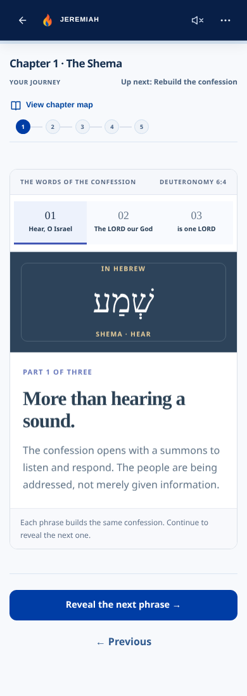
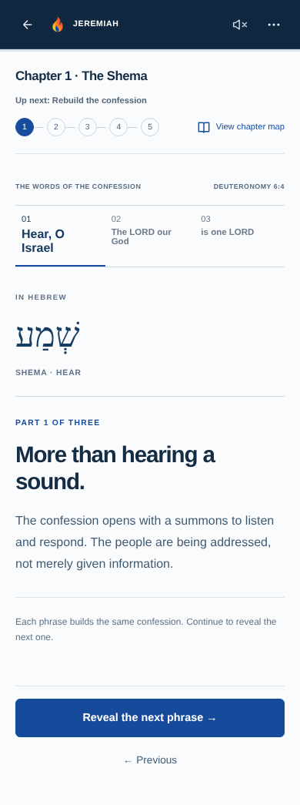
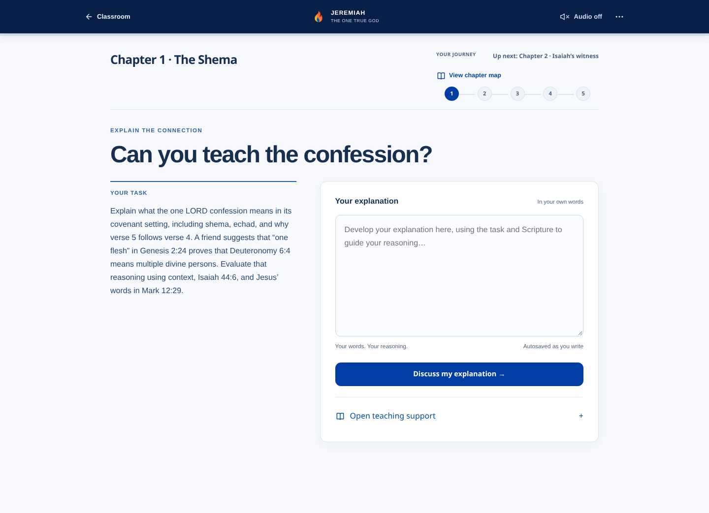
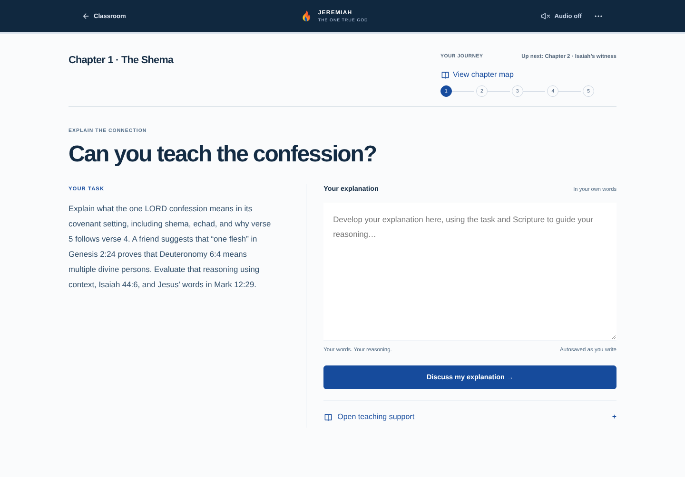

# Issue #54 — OG.1 Classroom redesign

## Review scope

Source branch: `feature/mobile-home-classroom-theme-pass1`, commit `7a64e28fb500d0e68a7531895223b072a581edbd`. Implementation branch: `codex/og1-classroom-premium-layout-v1`. This is the existing full Stage 2 app, not old main or a replacement application. No merge, production deploy, domain, default-branch or Vercel setting change.

The work is inside the OG.1 learning experience. Home, classroom entry/catalogue, Bible reader, learner data, curriculum, questions, narrator, imagery assets and pilot/survey implementations remain unchanged. The repeated “Hear this phrase” controls remain removed.

## Composition decisions

| Learning task | New experience | Phone / desktop distinction |
| --- | --- | --- |
| Opening | Actual Moses/Israel image, KJV passage and discovery note form one triptych. Decorative light rings and nested discovery box are removed. | Phone follows image → passage → explanation; desktop places the actual image beside passage and note. |
| Shema encounter | Landscape and reading column, with the one optional Scripture listen retained. | Phone gets a panoramic image above the passage; desktop uses an image/reading spread. |
| Phrase study | A three-part ruled study rail, RTL Hebrew and a clear explanation column. No audio CTA per phrase. | Phone reads the active phrase and meaning vertically; desktop pairs Hebrew with its interpretation across a divider. |
| Response | Semantic task and writing regions. The desk is an open writing surface, not a card inside a card. Required prompt always remains visible; support retains its provenance. | Task and writing sit side-by-side on desktop, sequentially on phone. Input and actions remain in ordinary flow on short viewports. |
| Isaiah | A source image plus a cumulative ruled evidence ledger. Prior declarations remain visible. | Desktop has a source-image column; phone uses a panorama and compact sequential entries. |
| Moses → Jesus → Paul | Witness navigation, current image/passage and retained testimony form a timeline rather than a deck of cards. | Desktop uses a vertical witness rail and landscape scene; phone uses a compact witness strip and a single passage scene. DOM witness order remains chronological. |
| Comparison | A shared-confession line anchors two equally weighted reading columns. No decorative circle or opposed colored cards. | Desktop has equal columns; phone stacks equivalent ruled sections. All source teaching and conclusions are retained. |
| Devotion | The confession/response passages sit in a connected reading spread. Consequences remain image-led. | Side-by-side Scripture on desktop, sequential passages on phone. No private reflection is newly graded. |
| Chapter map | A dedicated focus view; the active task stays mounted but hidden while exploring. | Desktop has a five-part horizontal route; phone has a compact chapter index. Closing restores task and trigger focus; saved state is unchanged. |
| Exam/review | Assessment studio with a quiet brief and one question surface. Choices are ruled rows, not individual cards. Results and answer explanations remain available. | Desktop brief sits beside questions; phone uses a compact introduction and five-column question navigation. |
| Understanding | A semantic five-standard evidence ledger. Result, meaning and next step remain visible. Optional evidence detail has a native disclosure. | Desktop aligns result/explanation columns; phone uses a readable sequential report without a stack of framed panels. Disclosure never changes scores/history. |
| Final synthesis | A concluding lead, linked witness quotations and the command that follows. | Desktop links four witnesses across a single strip; phone makes a compact vertical testimony trail. All words and Bible links remain. |

System/UI type is used for teaching, headings and controls; serif is reserved for quoted Scripture and Hebrew. Approved media remains unchanged; no font assets were introduced. The page has no universal card template.

## Stylesheet ownership and refactor

- Replaced the accumulated 1,094-line `OG1LessonPlayer.css` with page/navigation/reading structure.
- Rebuilt `ShemaExperience.css`, `OG1InteractiveExperience.css`, `OG1ResponseWorkspace.css`, `OG1StoryClimax.css` and `OG1ExitExam.css` around their actual task compositions.
- Extracted the report to `OG1UnderstandingReport.jsx` and its own stylesheet; it receives the unchanged `rateOG1Lesson` result.
- Removed `JeremiahLessonTheme.css` and its import. Removed the old global OG.1 recolor block from `jeremiahVisualSystem.css`.
- Restricted `OG1ThemeConsistency.css` to the artifact viewer and removed superseded shell/exam patches from Stage One. Toolbar, optional media, restart dialog and dark-summary accessibility remain.
- Existing style-source tests were updated to check the new ownership rather than require retired gradient overrides. Their exam/standards/scoring assertions were not removed. The rating presentation assertion now follows the extracted report and checks all evidence fields.

## Instructional and technical preservation

`git diff --exit-code 7a64e28 -- app/src/core app/src/data app/server app/api app/public app/src/features/home app/src/features/pilot app/vercel.json` passes. No changes to KJV content, OG.1.1–5 standards, authored prompts, rubrics, grading, narration/voice manifest, evidence provenance, storage keys, assessment history/restart archives or survey schema. Issue #48 instructional gaps are not silently changed by this visual implementation.

The only required Home test change repairs its pre-existing unescaped apostrophe in an assertion message. The original Home source is unchanged; the repaired runner exercises the same assertions at 320/390/768/1440.

## Verification

- Frozen `npm ci` and production build pass. CSS bundle decreases from 445.19 KB / 87.26 KB gzip to approximately 351 KB / 67 KB gzip; the existing large-JS-chunk warning remains.
- All 23 unique test commands from both GitHub CI workflows pass. [Command results](classroom-redesign-evidence/ci-results.json).
- [Stage 1 browser](classroom-redesign-evidence/stage1.log): authored labels, touch targets, narration Off/errors, media failure, keyboard restart, archived exam/history, actual ten-question exam, answer review, report → synthesis → survey, contrast, short viewport and reduced motion.
- [Stage 2 browser](classroom-redesign-evidence/stage2.log): unchanged prompts, autosave/reload, independent/support distinction, unavailable assessment without fabricated evidence, non-mutating map, reversible phrase reveals, retained Isaiah/witness evidence, audio preference, equal comparison treatment, responsive writing and fallbacks.
- [Brand browser](classroom-redesign-evidence/brand.log) and [Home browser](classroom-redesign-evidence/home.log) pass.
- [New composition browser](classroom-redesign-evidence/after.log): real before/after scenes, no repeated phrase-audio control, no horizontal overflow/page errors, desktop image/reading split, phone reading order, RTL Hebrew, focused map, report disclosure data preservation, 320×440 reachable response CTA/focus, and 768×1024 reduced-motion writing.
- Lint retains the existing 10 errors / 6 warnings after the baseline Home test parsing bug is repaired. No new lint finding in the changed application components. [Output](classroom-redesign-evidence/lint.log).

Browser tests use isolated synthetic learner data and mocked unavailable service responses. They do not call paid AI/narration, write real feedback, or claim live third-party API quality. Real grading algorithms and actual ten-question exam submission are separately exercised by the existing tests. No physical-device or screen-reader certification is claimed.

## Real screenshot comparisons

Chromium, deviceScaleFactor 2; screenshots exported at CSS resolution. Phone 390×844 and desktop 1440×1000. Short-screen 320×440 and tablet 768×1024 captures are included. These are real rendered application states, not mockups.

| Scene | Phone before | Phone after | Desktop before | Desktop after |
| --- | --- | --- | --- | --- |
| opener | [390 before](classroom-redesign-evidence/before/390-opener.png) | [390 after](classroom-redesign-evidence/after/390-opener.png) | [1440 before](classroom-redesign-evidence/before/1440-opener.png) | [1440 after](classroom-redesign-evidence/after/1440-opener.png) |
| phrase | [390 before](classroom-redesign-evidence/before/390-phrase.png) | [390 after](classroom-redesign-evidence/after/390-phrase.png) | [1440 before](classroom-redesign-evidence/before/1440-phrase.png) | [1440 after](classroom-redesign-evidence/after/1440-phrase.png) |
| response | [390 before](classroom-redesign-evidence/before/390-response.png) | [390 after](classroom-redesign-evidence/after/390-response.png) | [1440 before](classroom-redesign-evidence/before/1440-response.png) | [1440 after](classroom-redesign-evidence/after/1440-response.png) |
| weak | [390 before](classroom-redesign-evidence/before/390-weak.png) | [390 after](classroom-redesign-evidence/after/390-weak.png) | [1440 before](classroom-redesign-evidence/before/1440-weak.png) | [1440 after](classroom-redesign-evidence/after/1440-weak.png) |
| unscored | [390 before](classroom-redesign-evidence/before/390-unscored.png) | [390 after](classroom-redesign-evidence/after/390-unscored.png) | [1440 before](classroom-redesign-evidence/before/1440-unscored.png) | [1440 after](classroom-redesign-evidence/after/1440-unscored.png) |
| isaiah | [390 before](classroom-redesign-evidence/before/390-isaiah.png) | [390 after](classroom-redesign-evidence/after/390-isaiah.png) | [1440 before](classroom-redesign-evidence/before/1440-isaiah.png) | [1440 after](classroom-redesign-evidence/after/1440-isaiah.png) |
| continuity | [390 before](classroom-redesign-evidence/before/390-continuity.png) | [390 after](classroom-redesign-evidence/after/390-continuity.png) | [1440 before](classroom-redesign-evidence/before/1440-continuity.png) | [1440 after](classroom-redesign-evidence/after/1440-continuity.png) |
| comparison | [390 before](classroom-redesign-evidence/before/390-comparison.png) | [390 after](classroom-redesign-evidence/after/390-comparison.png) | [1440 before](classroom-redesign-evidence/before/1440-comparison.png) | [1440 after](classroom-redesign-evidence/after/1440-comparison.png) |
| devotion | [390 before](classroom-redesign-evidence/before/390-devotion.png) | [390 after](classroom-redesign-evidence/after/390-devotion.png) | [1440 before](classroom-redesign-evidence/before/1440-devotion.png) | [1440 after](classroom-redesign-evidence/after/1440-devotion.png) |
| map | [390 before](classroom-redesign-evidence/before/390-map.png) | [390 after](classroom-redesign-evidence/after/390-map.png) | [1440 before](classroom-redesign-evidence/before/1440-map.png) | [1440 after](classroom-redesign-evidence/after/1440-map.png) |
| exam | [390 before](classroom-redesign-evidence/before/390-exam.png) | [390 after](classroom-redesign-evidence/after/390-exam.png) | [1440 before](classroom-redesign-evidence/before/1440-exam.png) | [1440 after](classroom-redesign-evidence/after/1440-exam.png) |
| understanding | [390 before](classroom-redesign-evidence/before/390-understanding.png) | [390 after](classroom-redesign-evidence/after/390-understanding.png) | [1440 before](classroom-redesign-evidence/before/1440-understanding.png) | [1440 after](classroom-redesign-evidence/after/1440-understanding.png) |
| synthesis | [390 before](classroom-redesign-evidence/before/390-synthesis.png) | [390 after](classroom-redesign-evidence/after/390-synthesis.png) | [1440 before](classroom-redesign-evidence/before/1440-synthesis.png) | [1440 after](classroom-redesign-evidence/after/1440-synthesis.png) |
| media-failure | [390 before](classroom-redesign-evidence/before/390-media-failure.png) | [390 after](classroom-redesign-evidence/after/390-media-failure.png) | [1440 before](classroom-redesign-evidence/before/1440-media-failure.png) | [1440 after](classroom-redesign-evidence/after/1440-media-failure.png) |

| Additional viewport | Before | After |
| --- | --- | --- |
| 320×440 | [Before](classroom-redesign-evidence/before/320-responsive.png) | [After](classroom-redesign-evidence/after/320-responsive.png) |
| 768×1024 | [Before](classroom-redesign-evidence/before/768-responsive.png) | [After](classroom-redesign-evidence/after/768-responsive.png) |

### A direct look at the phrase-study redesign

| Phone before | Phone after |
| --- | --- |
|  |  |

### Desktop response workspace

Before:



After:



## Reproduce

From `app/`: `npm ci`, `npm run build`, then `PORT=4184 PILOT_FEEDBACK_FILE=/tmp/jeremiah-redesign-test-feedback.jsonl npm start`. With Playwright and Chromium available to the review runner:

```sh
JEREMIAH_REVIEW_URL=http://127.0.0.1:4184 node scripts/verify-og1-stage1-browser.cjs
JEREMIAH_REVIEW_URL=http://127.0.0.1:4184 node scripts/verify-og1-stage2-browser.cjs
JEREMIAH_REVIEW_URL=http://127.0.0.1:4184 JEREMIAH_SCREENSHOT_DIR=/tmp/brand-review node scripts/verify-brand-stage2-browser.cjs after
JEREMIAH_REVIEW_URL=http://127.0.0.1:4184 node scripts/verify-home-experience-browser.cjs
JEREMIAH_REVIEW_URL=http://127.0.0.1:4184 node scripts/verify-classroom-redesign-browser.cjs after
```

No browser dependency was added to the application. Hosted preview and GitHub checks are reported on the draft PR. Production is untouched.
