# Issue #59 — premium arrival and a discoverable witness preview

Correction branch: `codex/shema-card-witness-flow-correction`, rooted directly in approved PR #57, `85d7c731cc24972760509bbd95915d89814abcf1`. No PR #55 changes, no merge/cherry-pick of #58, no production or hosting configuration changes.

## What actually regressed

We ran the exact #57 and #58 sources in Chromium at **390×844** and **1440×1000**, entering through consent → Start the lesson with empty browser storage. Screenshots are actual rendered pages, not mockups or seeded lesson positions. Both reference builds use the same unchanged local assets.

PR #58's opener added witness choices but its dominant action actually said **“Continue to the next activity →”**. Pressing it once left after Moses, without Isaiah, Jesus or Paul. Its small choices were an optional discovery that a CTA-first learner missed. The actual label came from the last-moment fallback in the player, rather than the intended witness invitation.

The approved phrase study still existed later in both builds. Both routes first passed through an older `shema-world` encounter: full-photo backdrop and oversized pale “hear it.” typography, visually unlike the approved signature card. Checking only whether the signature component existed missed what the student actually saw first. Late theme rules also overrode styles; the new opening and arrival use narrowly scoped selectors, verified in the real cascade.

## What changed

One image-led preview now pairs each existing biblical scene/KJV quotation with a question and the full existing witness explanation. Large portrait choices show **On screen / Viewed / Up next / Explore**. At the point of action: **“Tap a witness—or follow with the blue button.”** The first untouched witness receives a short two-cycle invitation pulse; reduced-motion removes it.

The dominant action follows the next unseen witness inside the same card. It never silently leaves the only interaction. The separate **Skip preview · Begin Chapter 1** action is explicit and ungraded. There are no four added mandatory lesson pages or extra quizzes.

Chapter 1's first encounter now shares the approved image-led visual language: appropriate Moses scene, bold full KJV confession, Hebrew/meaning introduction, restrained navy/gold and a clear reading surface. The **approved phrase-study component and its entire CSS remain byte-for-byte unchanged**. Scripture, full explanation/language teaching, independent recitation, supported/unscored teacher feedback, score/history, chapters, global audio and survey remain intact. No “Hear this phrase” buttons.

## Real phone comparison — same fresh-learner checkpoints

Click any image for native 390×844 resolution. `-full.png` siblings record the full page without cropping.

| Checkpoint | Approved PR #57 | Unapproved PR #58 | Issue #59 correction |
| --- | --- | --- | --- |
| Opening | 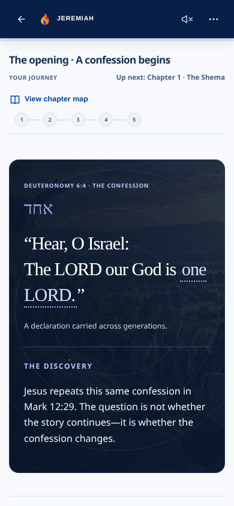 | 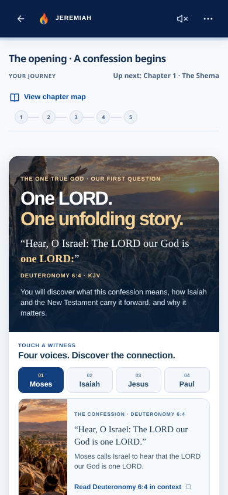 | 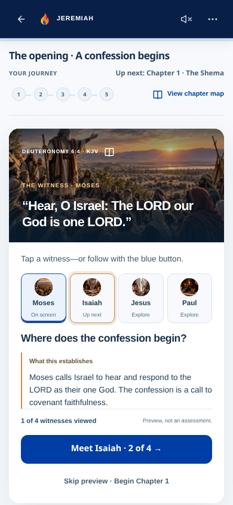 |
| Encounter | 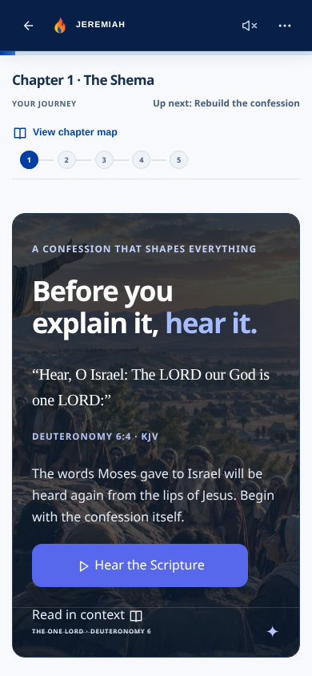 | 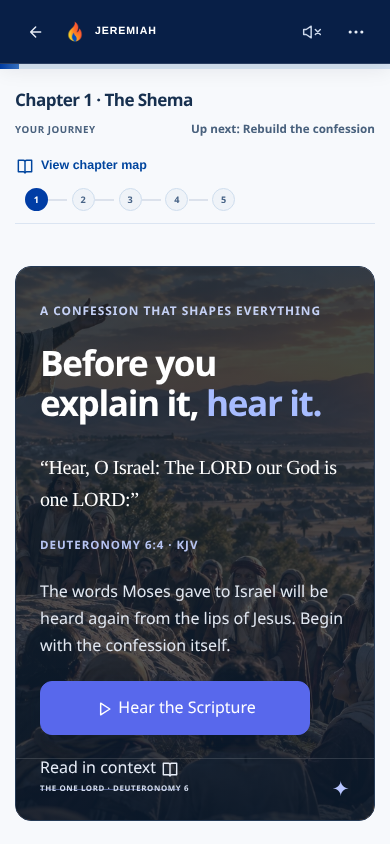 | 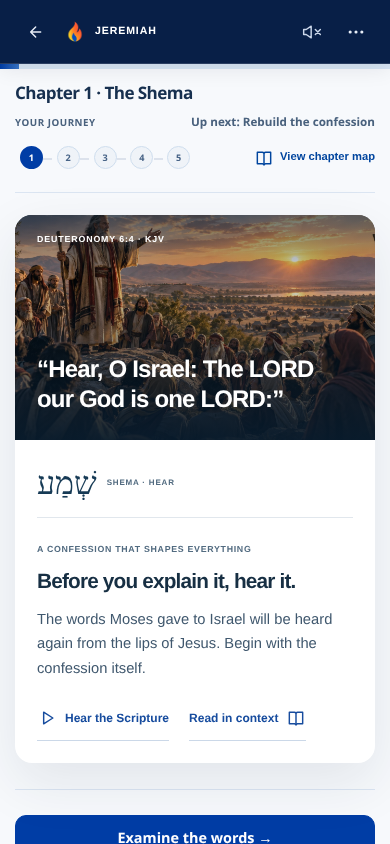 |
| Phrase | 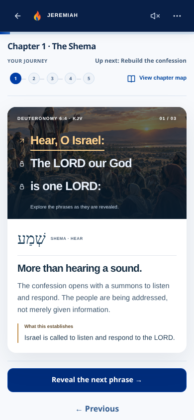 | 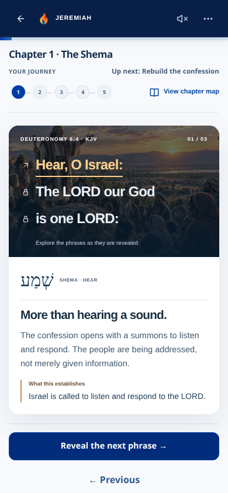 | 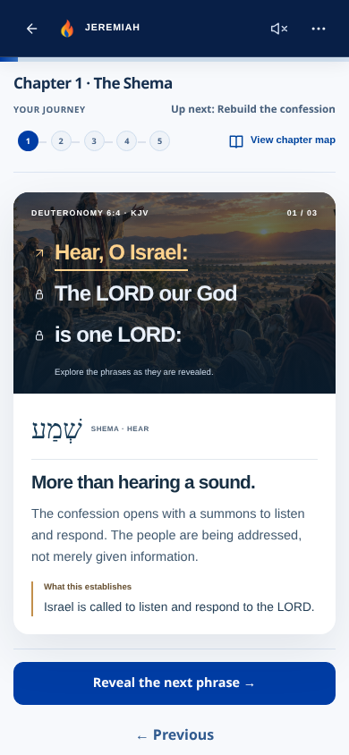 |

## Real desktop comparison — 1440×1000

| Checkpoint | Approved PR #57 | Unapproved PR #58 | Issue #59 correction |
| --- | --- | --- | --- |
| Opening | 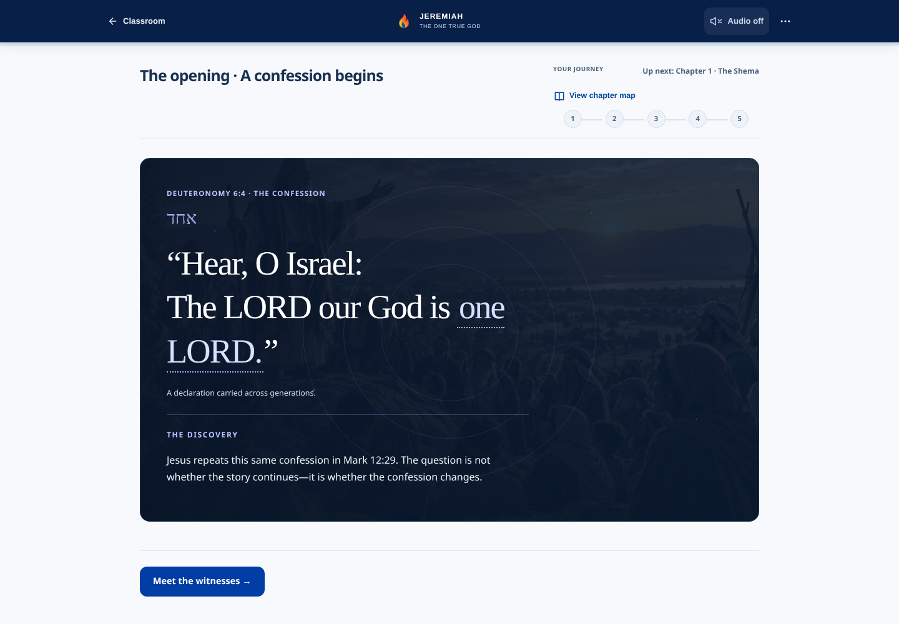 | 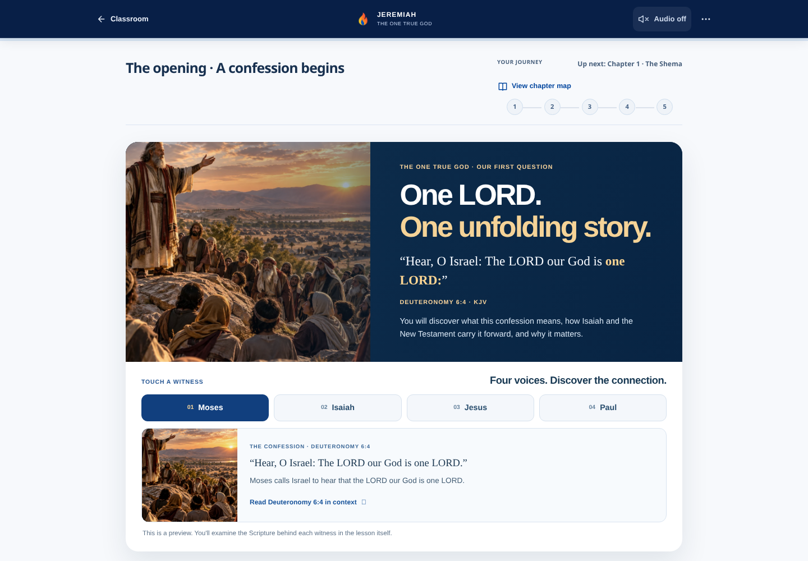 | 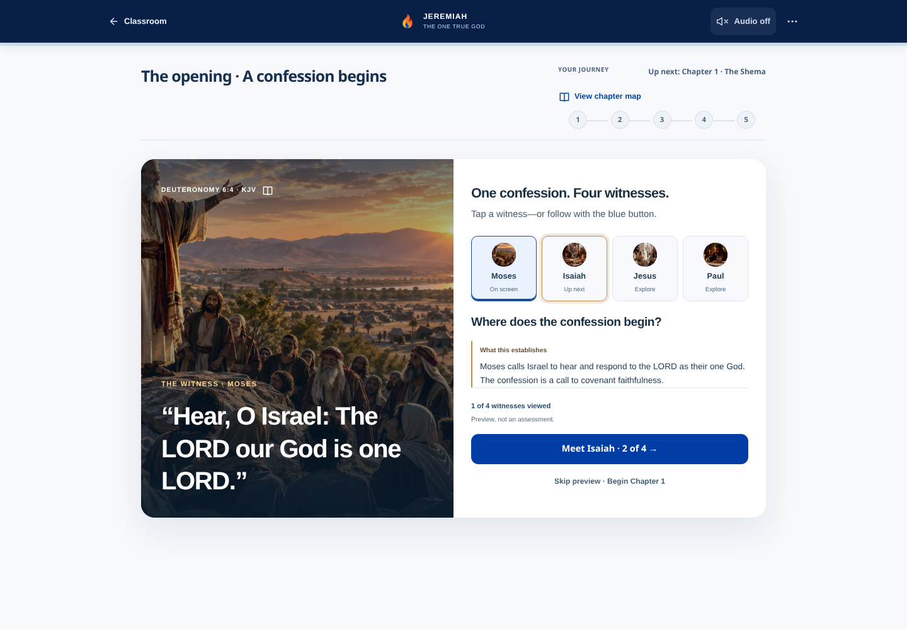 |
| Encounter |  | 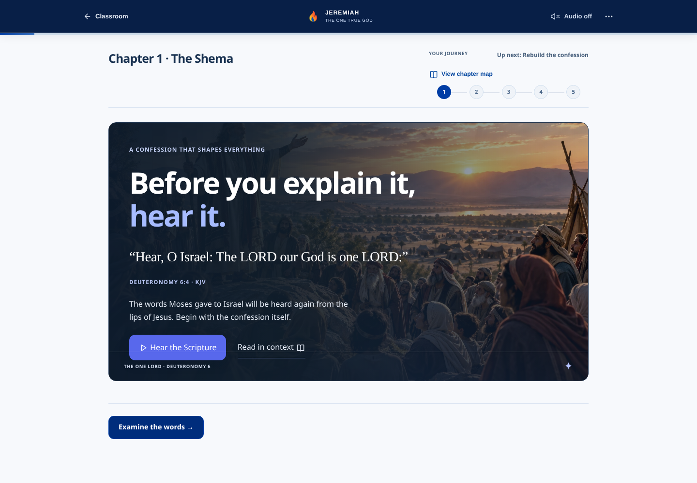 | 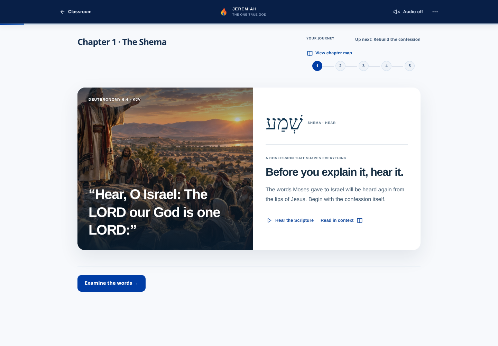 |
| Phrase |  | 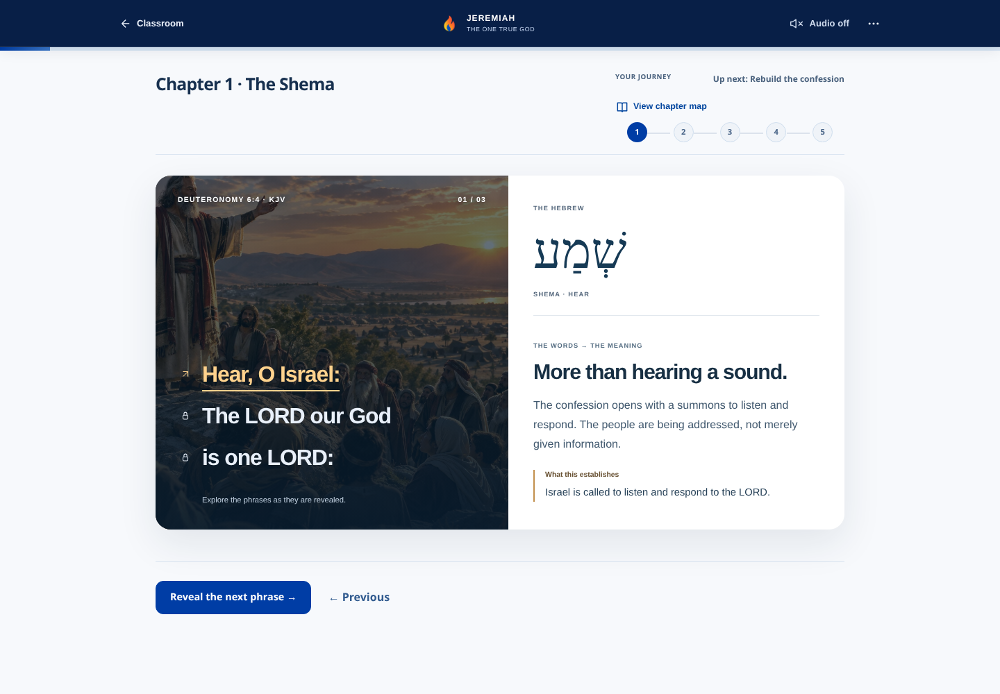 |  |

## First-time learner behavior

The new browser runner never seeds lesson storage. Every case starts at actual consent and Start. Narration is switched off through the existing UI. API responses are deliberately unavailable during screenshot capture: this tests local lesson behavior and failure tolerance, not live model or speech-provider quality.

| Learner behavior | Observed result |
| --- | --- |
| Press only the dominant blue action | Moses → **Meet Isaiah · 2 of 4** → **Meet Jesus · 3 of 4** → **Meet Paul · 4 of 4** → **Begin Chapter 1 · The Shema** → modern encounter → approved phrase card. |
| Intentionally choose Paul → Isaiah → Jesus | Each reveals its own scene, Scripture, question and explanation. All four viewed; Begin is available directly, without forcing repeats. |
| Explicitly skip | Enters Chapter 1 immediately; no invented assessment, evidence, mastery or score. |
| Keyboard on 320×440, reduced motion | Arrow keys select witnesses; Home/End supported; visible focus; no invitation animation; main target at least 44px; normal vertical scrolling, no horizontal overflow. |
| All images unavailable | Text/interaction remain usable; all four witnesses still traversable; encounter and approved phrase fallback reachable. |

On the 390×844 phone, the primary action remains above the fold for **all four** witnesses: its bottom is at 774.5–797.4px. The test asserts this after resetting scroll to the top. Each preview is labelled **“Preview, not an assessment.”** Reaching these four presentations does not claim understanding; existing later assessments still measure it.

What the learner sees and learns: Moses establishes covenant faithfulness to the one LORD; Isaiah excludes a rival before, beside or after; Jesus affirms the confession when asked about the first commandment; Paul applies it to idol worship. Each is visible with its existing Scripture and explanation before the dominant action moves onward. No timed barrier prevents entering the lesson within the first minute; reading comprehension and retention require real student research beyond this automated behavior test.

Phone witness states: [Moses](opening-correction-evidence/after/390-witness-moses.png), [Isaiah](opening-correction-evidence/after/390-witness-isaiah.png), [Jesus](opening-correction-evidence/after/390-witness-jesus.png), [Paul](opening-correction-evidence/after/390-witness-paul.png).

Additional captures: [320×440 keyboard/reduced motion](opening-correction-evidence/after/320-short-keyboard.png), [full short-phone page](opening-correction-evidence/after/320-short-keyboard-full.png), [image fallback](opening-correction-evidence/after/390-image-fallback.png).

Machine-readable actual routes: [#57](opening-correction-evidence/pr57/flows.json), [#58](opening-correction-evidence/pr58/flows.json), [correction including CTA geometry](opening-correction-evidence/after/flows.json).

## Validation

- Production build: pass.
- All **23** commands used by the repository CI workflows: pass. [Results](opening-correction-evidence/checks/jeremiah-opening-tests.json).
- Stage 1 browser: pass; full exit exam/history/restart archives, results/report/survey, narration Off/failure, dialog keyboard, short viewport and contrast.
- Stage 2 browser: pass; every original written prompt, autosave/reload, support provenance, independent recall, unscored continuation, retained evidence and trail, chapter map, responsive inputs.
- Original Shema-card browser suite: pass at 390×844, 1440×1000 and 320×440; all three phrases, reached-phrase review/history, no repeated audio.
- New CTA-first browser runner: pass; fresh entry on phone/desktop, dominant-only route, intentional exploration, skip, keyboard, reduced motion, image fallback, overflow, no browser exceptions.
- Lint: **11 existing errors and 6 warnings**, with every reported file identical to #57. No new lint findings. [Output](opening-correction-evidence/checks/jeremiah-opening-lint.log).
- [Preservation verification](opening-correction-evidence/checks/preservation.txt). No data/schema migration, package/lock changes, backend edits, new assets or hosting edits.

Build and browser logs are in [checks](opening-correction-evidence/checks/). Reproduce against a local production server on 4184:

```sh
cd app
npm run build
PORT=4184 npm start
# In another shell with Playwright installed and Chromium available:
NODE_PATH=/path/to/playwright/node_modules node scripts/verify-opening-correction-browser.cjs after
```

The screenshot runner also accepts `JEREMIAH_REVIEW_URL`, `CHROMIUM_PATH` and `JEREMIAH_SCREENSHOT_DIR`. For exact baselines run it with `pr57` or `pr58` against those sources. Browser regressions additionally use the existing `verify-og1-stage1-browser.cjs`, `verify-og1-stage2-browser.cjs` and `verify-shema-card-browser.cjs after` runners.

## Review scope

Draft PR targets `codex/shema-premium-card-prototype`. Preview opens at `/#pilot`; start fresh, accept consent and press only the blue action. Compare with intentional witness selection and the explicit skip. Hosting previews may require the existing Vercel sign-in; local production-build screenshots/test logs above remain directly reviewable. No merge, production deploy or production settings change is authorized or performed.
