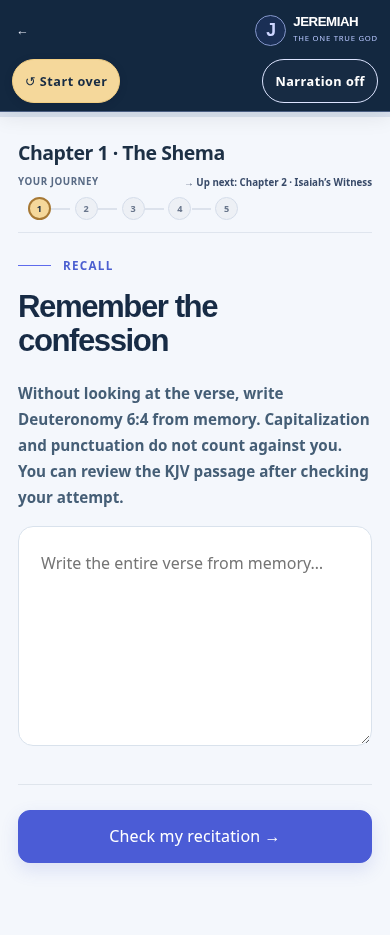
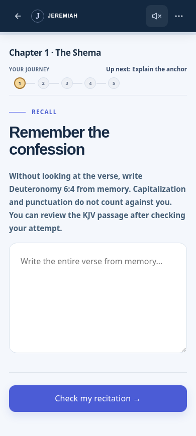

# OG.1 Stage 1 review — issue #43

Implementation branch: `codex/og1-stage1-design-repairs`
Base: `feature/og1-shema-blueprint-pass1` at `8f759f99eb6eed29ba2f9231d40cbefea5948f7f`.

This implements the Stage 1 scope approved by the owner, following issue #43 and
the design assessment in PR #42. It does not implement Stage 2 interactions or
Stage 3 cinematic redesign. No merge, production deployment, domain/secret change
or curriculum migration was performed.

## What changed

- Summary prose now uses an explicit on-dark foreground rather than inheriting
  the light-page paragraph color. The original synthesis and biblical art remain.
- Chapter location derives from the move's `standardIds` and `lessonChapters`.
  Context/prayer challenges are in Chapters 1/4; next-task labels follow the actual
  authored graph. Exam in progress, results, understanding, summary and optional
  survey have separate labels. Covered chapters are never described as mastered.
- A compact, single-row lesson toolbar keeps back/audio available. Back is at
  least 44×44px. Lesson options contains the five-chapter contents and a quiet
  restart action; no new chapter-skipping or progression behavior is introduced.
- Restart uses a native modal dialog with explicit Tab/Shift+Tab wrap, initial
  focus on Cancel, Escape cancel, scroll locking and focus return. Existing full
  archive/history logic is unchanged. Restart resets the local ending view for
  the new run without modifying archived assessments.
- The report action follows the exam score, before optional detailed review.
  Every answer explanation and retry remains accessible, including a direct
  review shortcut. Actions remain in document flow; none overlays an input or
  phone keyboard.
- Isaiah's fallback follows the active 43:10 / 44:6 / 43:10 sequence, with readable
  passage metadata rather than a blurred, mismatched manuscript label.
- Optional video loads only on request. Attribution, original embed URL and
  optionality remain; a persistent “Continue without video” path handles blocked
  cross-origin embeds, which cannot reliably report playback failure. No fabricated
  poster/media source or automatic success claim is introduced.
- Active OG.1 playback/context controls use small inline SVGs instead of
  OS-colored playback emoji and unreliable link glyphs. Turning narration off
  clears stale errors and stops playback; reading remains complete without audio.

## Preservation checks

No changes to curriculum/standards/Scripture data, questions, scoring and weights,
learning engine, teacher evaluation, restart archive implementation, saved-state
schema, narration manifest, biblical image assets/catalogue, Lesson Blueprints,
inline Bible source or pilot survey schema/storage. `package.json` only extends
an existing test command; dependency declarations and lockfile are unchanged.
No source work from other branches was merged or reset.

Source-shape assertions in the old journey/exam tests were updated to test the
new presentation integration and authored destinations; objective grading,
evidence, progression and storage assertions remain. A new semantic location
regression runs as part of the existing `test:og1-journey` CI command.

## Real rendered visual evidence

Captured the baseline before edits, then the built implementation with local
Node servers and Chromium 155.0.8059.79 / installed Playwright, device scale 1.
Viewport heights: 844px at 320/390px widths; 1000px at 1440px. Screens are current
UI, not mockups. Synthetic completed-exam fixtures were used only in isolated
browser storage; they are not real learner outcomes. No real survey was submitted.

The table contains **42 before/after images**: six required states at three
widths, plus reduced-motion recall at each width. Phase-by-phase document size
measurements are in the two `metrics.json` files. No horizontal overflow in this
matrix. Reduced-motion phrase animation was additionally verified in-browser;
this is not a claim to have tested a physical phone, screen reader or all motion.

| State | 320px before / after | 390px before / after | 1440px before / after |
| --- | --- | --- | --- |
| Chapter | [Before](stage1-evidence/before/320-chapter.png) · [After](stage1-evidence/after/320-chapter.png) | [Before](stage1-evidence/before/390-chapter.png) · [After](stage1-evidence/after/390-chapter.png) | [Before](stage1-evidence/before/1440-chapter.png) · [After](stage1-evidence/after/1440-chapter.png) |
| Recitation | [Before](stage1-evidence/before/320-recitation.png) · [After](stage1-evidence/after/320-recitation.png) | [Before](stage1-evidence/before/390-recitation.png) · [After](stage1-evidence/after/390-recitation.png) | [Before](stage1-evidence/before/1440-recitation.png) · [After](stage1-evidence/after/1440-recitation.png) |
| Isaiah | [Before](stage1-evidence/before/320-isaiah.png) · [After](stage1-evidence/after/320-isaiah.png) | [Before](stage1-evidence/before/390-isaiah.png) · [After](stage1-evidence/after/390-isaiah.png) | [Before](stage1-evidence/before/1440-isaiah.png) · [After](stage1-evidence/after/1440-isaiah.png) |
| Results | [Before](stage1-evidence/before/320-results.png) · [After](stage1-evidence/after/320-results.png) | [Before](stage1-evidence/before/390-results.png) · [After](stage1-evidence/after/390-results.png) | [Before](stage1-evidence/before/1440-results.png) · [After](stage1-evidence/after/1440-results.png) |
| Summary | [Before](stage1-evidence/before/320-summary.png) · [After](stage1-evidence/after/320-summary.png) | [Before](stage1-evidence/before/390-summary.png) · [After](stage1-evidence/after/390-summary.png) | [Before](stage1-evidence/before/1440-summary.png) · [After](stage1-evidence/after/1440-summary.png) |
| Restart | [Before](stage1-evidence/before/320-restart.png) · [After](stage1-evidence/after/320-restart.png) | [Before](stage1-evidence/before/390-restart.png) · [After](stage1-evidence/after/390-restart.png) | [Before](stage1-evidence/before/1440-restart.png) · [After](stage1-evidence/after/1440-restart.png) |
| Recitation Reduced Motion | [Before](stage1-evidence/before/320-recitation-reduced-motion.png) · [After](stage1-evidence/after/320-recitation-reduced-motion.png) | [Before](stage1-evidence/before/390-recitation-reduced-motion.png) · [After](stage1-evidence/after/390-recitation-reduced-motion.png) | [Before](stage1-evidence/before/1440-recitation-reduced-motion.png) · [After](stage1-evidence/after/1440-recitation-reduced-motion.png) |

The main mobile change, before / after:

<table><tr><th>Before</th><th>After</th></tr><tr><td></td><td></td></tr></table>

## Validation

- **25 of 26 package-defined test commands passed**, including every test command
  covered by the two existing CI workflows. The new 20-move location checks pass.
  See [command results](stage1-evidence/test-results.json).
- `test:bible-source` failed with `fetch failed`; the environment's eBible access
  was already blocked before implementation. Parser, inline-reader, narration,
  exam, rating, grouped lesson, pilot and Vercel contract tests passed. This does
  not establish live remote service availability.
- Production build passed. Existing large-chunk warning remains (approximately
  1,017kB JS / 292kB gzip); bundle redesign is outside Stage 1.
- Lint still fails on **10 pre-existing errors and six warnings**, down from the
  baseline's 12 errors/six warnings after removing two unused ending-view values.
  No new lint errors appeared in the added components. Existing lint problems were
  not suppressed and are not represented as a passing check.
- The committed `app/scripts/verify-og1-stage1-browser.cjs` verifies all 20 rendered
  move labels/next destinations; real ten-answer exam submission and reload;
  results/report/summary/survey status; access to all ten explanations; empty
  independent recall; media failure/continue; audio Off; 44px back target; modal
  Tab/Shift+Tab/Escape/Cancel/return; complete archived exam/history after restart;
  reduced motion; short-viewport input/action layout; and zero page exceptions.
- Summary computed foreground is `rgb(223,229,250)`. Against gradient endpoints
  `#172B49` / `#323F77`, contrast is **11.32:1 / 7.92:1** (baseline 2.34:1 /
  1.64:1). These exceed 4.5:1 for normal prose. Original text is unchanged.
- Chromium safe-area emulation with top 44px / bottom 34px produced **52px header
  top padding / 82px content bottom padding**, without horizontal overflow.
  Keyboard accommodation was checked with a 320×440 viewport and no fixed/sticky
  action overlay. Physical mobile keyboards/audio still require device review.

To reproduce functional browser verification in an environment with Playwright
and Chromium already installed:

```sh
cd app
npm run build
PORT=4182 npm start
# In a second terminal:
node scripts/verify-og1-stage1-browser.cjs
```

Set `JEREMIAH_REVIEW_URL` or `CHROMIUM_PATH` for a different local server/browser.
The test uses fresh browser storage and mocked external audio/Bible failures;
it makes no paid provider requests and no survey submissions.

## Preview and remaining limits

The local built application was visually inspected; the screenshot matrix is the
browser-accessible review evidence in GitHub. A self-contained visual gallery is
also supplied with the task response for review without a deployment. This is a
visual preview, not a claim that a hosted interactive deployment was verified.

The environment still blocks GitHub's API and the Vercel preview destination.
If PR creation is blocked, the implementation branch and comparison URL are the
handoff; no production setting or credentials should be changed to manufacture a
successful preview. Live narration quality, external video playback, full Bible
chapter retrieval, physical iOS/Android and screen-reader behavior remain outside
what this restricted environment could verify. Existing no-audio/text paths and
media failure behavior were tested explicitly.
