# Issue #61 — the question begun by “one LORD”

Branch `codex/echad-scripture-teaching-progression`, based directly on the latest PR #60 head **74ff25f8dd626d6e25238a82def6391e61c2a833**. Draft base: `codex/shema-card-witness-flow-correction`. No main/#55/#58 merges or production/hosting changes.

## What the student was missing

In PR #60, the main route reached “Echad means one” without explaining why Christians agreeing on one God would examine that word. Genesis, Isaiah and Jesus appeared together without an explicit contribution/limit for each. Later, the identity deck held three questions, but the dominant action left after the first; baptism and prayer could be missed. The following comparison named two positions without making it the answer to a question the learner knew was coming.

The authored `show(...).teaching` contains important reasoning, but the interactive player does not generally render that array. Adding copy to it would not fix the actual experience. The new visible reveals teach the reasoning directly. In particular, the classical meanings of **essence, person and proceeding**, and the genuine humanity/real-prayer explanation, now appear before their unchanged assessment asks for them.

## Instructional sequence now visible on screen

| Moment | What the learner sees and can explain | Main action |
| --- | --- | --- |
| Approved phrase 3 | “is one LORD,” with the original Hebrew and full approved explanation | Continue to the existing optional film |
| Deuteronomy 6:4–5 | Confession and wholehearted response; asks what “one” establishes and what still needs explaining about Father, Son and Spirit | Why examine the word one? |
| Echad introduction | “One” highlighted **inside the actual KJV confession**, its Hebrew source and simple meaning. Both views affirm one God; the early definitions explain their difference. Either interpretation can be explored, without a correct option or grade | Follow the word in Scripture |
| Genesis 2:24 | Word usage: “one flesh” describes marriage. It neither proves nor refutes multiple divine persons; this is not presented as the basis of all Trinitarian theology | Add Isaiah’s witness |
| Isaiah 44:6 | The LORD excludes every rival. Both readings affirm this exclusivity; that fact alone does not explain Father/Son/Spirit | Hear Jesus repeat it |
| Mark 12:29 | Jesus repeats the Shema. Continuity matters, but does not itself explain incarnation or prayer | Gather what the texts establish |
| Echad conclusion | “One” starts the inquiry; neither interpretation rests on a dictionary proof. Explicit promise to return through Isaiah, Paul, Word, baptism and prayer | Practice what the confession means |
| Existing Chapters 2–3 | Original Isaiah and New Testament witness, teaching and assessments retained | Original lesson actions |
| Identity: Word | Recalls the early question, then **John 1:1 and 1:14**, with both readings and the actual disagreement | Follow the baptism passages |
| Identity: name | **Matthew 28:19 and Acts 2:38**, with both readings and the limit of drawing a complete doctrine from a singular noun | Follow Jesus’ prayer |
| Identity: prayer | **Luke 22:42 and 1 Timothy 2:5**, with real human willing/mediation in both accounts and the Apostolic explanation of genuine incarnation | Now compare the interpretations |
| Comparison | Shared one God and genuine incarnation; accurate classical essence/person/proceeding, followed by Apostolic Oneness, with equal visual treatment | Explicitly names the next reading, then gathers the answer |
| Doctrinal synthesis | Names the question answered, the cumulative Scripture reasons, the Apostolic conclusion and its interpretive limits; connects to Deuteronomy 6:5 | Existing application/assessment |
| Return to devotion | Recalls what was concluded, then the original confession → wholehearted response | Existing devotion journey |

This is a cumulative argument within the existing lesson scenes, not added graded theology trivia. The three former Hebrew examples are now sequential contributions, rather than disconnected simultaneous panels. The later question deck is parent-guided: the main action visits every pair; reached pairs can be reviewed with buttons, arrows, Home and End. All six passage references have their own working in-context action (including John 1:14 and 1 Timothy 2:5, which the former split-reference shortcut missed).

A guided Next/Previous reveal returns to the beginning of the new explanation. The browser test checks that **before** screenshot positioning: otherwise a learner pressing Next at the bottom could miss the new explanation above them. Optional keyboard review retains control focus.

## Real before/after screenshots

These are Chromium renders at native **390×844** and **1440×1000**, reached from consent → Start in **fresh browser storage**. No lesson state was seeded and no teaching moves were skipped. Synthetic answers exercise the real matching/reasoning/recitation/written controls between chapters. API failures are deliberately simulated, so remote written assessment is saved/unscored, not represented as a real teacher judgment. Optional film is bypassed through its existing Continue action; narration is turned off through the actual toolbar.

Each cell has its native viewport image plus **full page** and **action viewport** links. The action viewport shows the real transition button with its adjacent explanation. Some teaching cards require vertical reading/scrolling on phone; the screenshots and measured CTA positions do not claim all explanations fit above the fold. Controls remain in normal flow, with no fixed action over teaching or inputs.

PR #60 has one combined echad screen and only the Word question on its main-action route. Its same echad capture is therefore compared against the introduction and conclusion; the additional evidence states are separately linked below.

## Phone comparison — 390px

| Checkpoint | PR #60 before | Issue #61 after |
| --- | --- | --- |
| Phrase 3 | 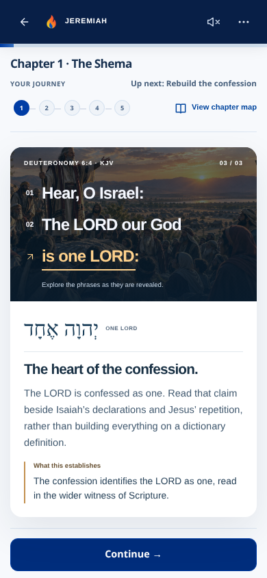 [Full page](teaching-progression-evidence/before/390-phrase-3-full.png) · [Action](teaching-progression-evidence/before/390-phrase-3-action.png) |  [Full page](teaching-progression-evidence/after/390-phrase-3-full.png) · [Action](teaching-progression-evidence/after/390-phrase-3-action.png) |
| Deut 6:4–5 → the question |  [Full page](teaching-progression-evidence/before/390-connection-full.png) · [Action](teaching-progression-evidence/before/390-connection-action.png) | 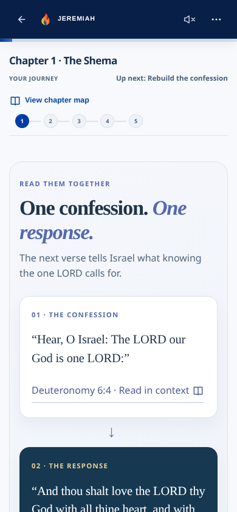 [Full page](teaching-progression-evidence/after/390-connection-full.png) · [Action](teaching-progression-evidence/after/390-connection-action.png) |
| Echad introduction | 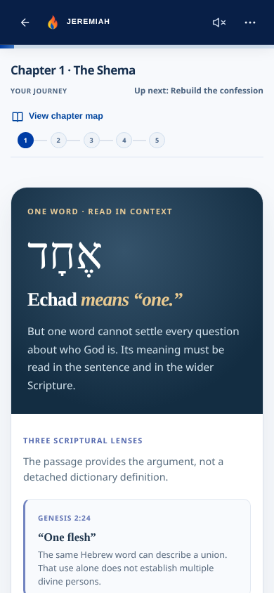 [Full page](teaching-progression-evidence/before/390-echad-intro-full.png) · [Action](teaching-progression-evidence/before/390-echad-intro-action.png) | 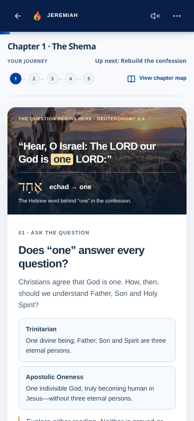 [Full page](teaching-progression-evidence/after/390-echad-intro-full.png) · [Action](teaching-progression-evidence/after/390-echad-intro-action.png) |
| Echad evidence → conclusion |  [Full page](teaching-progression-evidence/before/390-echad-intro-full.png) · [Action](teaching-progression-evidence/before/390-echad-intro-action.png) | 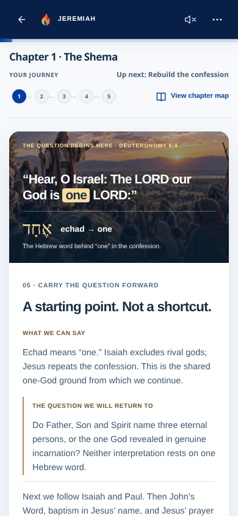 [Full page](teaching-progression-evidence/after/390-echad-conclusion-full.png) · [Action](teaching-progression-evidence/after/390-echad-conclusion-action.png) |
| Identity introduction → Word | 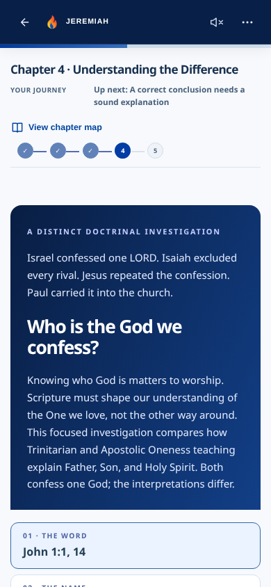 [Full page](teaching-progression-evidence/before/390-identity-word-full.png) · [Action](teaching-progression-evidence/before/390-identity-word-action.png) | 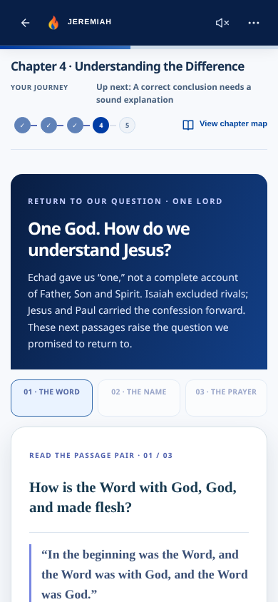 [Full page](teaching-progression-evidence/after/390-identity-word-full.png) · [Action](teaching-progression-evidence/after/390-identity-word-action.png) |
| Comparison: both interpretations | 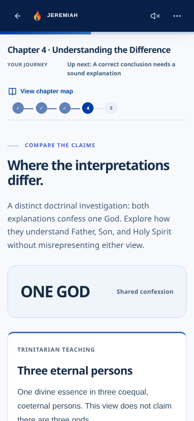 [Full page](teaching-progression-evidence/before/390-comparison-2-full.png) · [Action](teaching-progression-evidence/before/390-comparison-2-action.png) | 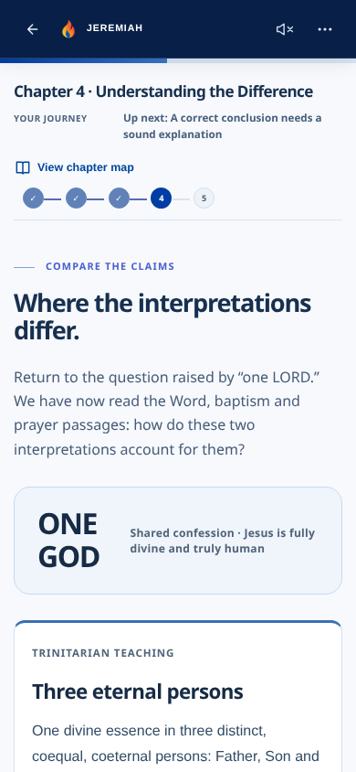 [Full page](teaching-progression-evidence/after/390-comparison-2-full.png) · [Action](teaching-progression-evidence/after/390-comparison-2-action.png) |
| Doctrinal synthesis | 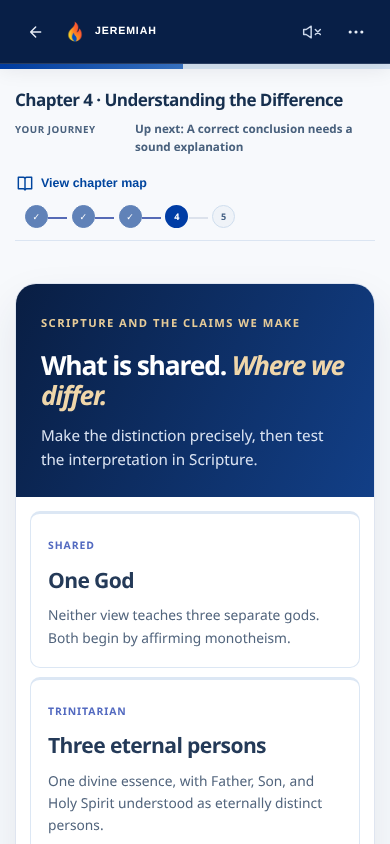 [Full page](teaching-progression-evidence/before/390-doctrinal-synthesis-full.png) · [Action](teaching-progression-evidence/before/390-doctrinal-synthesis-action.png) | 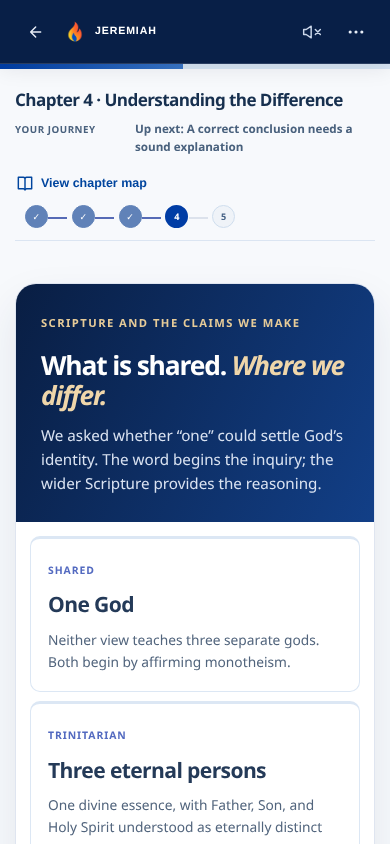 [Full page](teaching-progression-evidence/after/390-doctrinal-synthesis-full.png) · [Action](teaching-progression-evidence/after/390-doctrinal-synthesis-action.png) |
| Return to devotion | 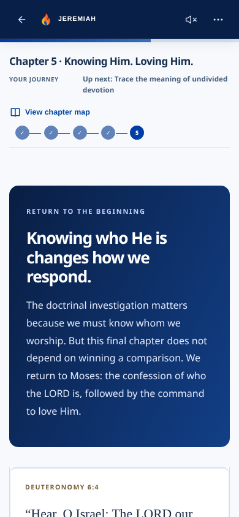 [Full page](teaching-progression-evidence/before/390-return-devotion-full.png) · [Action](teaching-progression-evidence/before/390-return-devotion-action.png) | 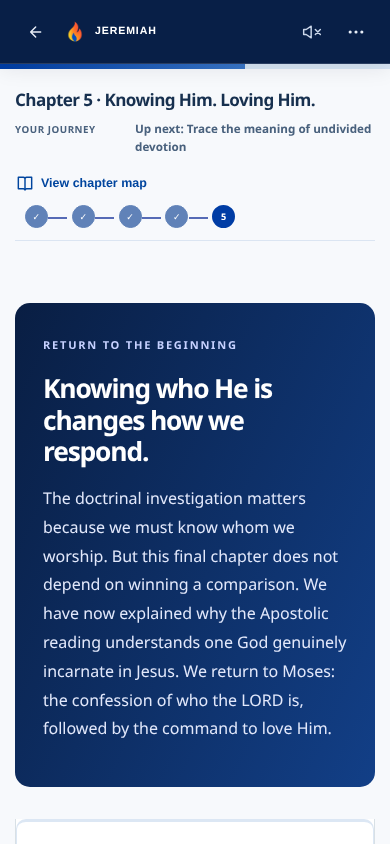 [Full page](teaching-progression-evidence/after/390-return-devotion-full.png) · [Action](teaching-progression-evidence/after/390-return-devotion-action.png) |

Additional guided reveals: [Genesis](teaching-progression-evidence/after/390-echad-genesis-full.png) / [action](teaching-progression-evidence/after/390-echad-genesis-action.png); [Isaiah](teaching-progression-evidence/after/390-echad-isaiah-full.png) / [action](teaching-progression-evidence/after/390-echad-isaiah-action.png); [Jesus](teaching-progression-evidence/after/390-echad-jesus-full.png) / [action](teaching-progression-evidence/after/390-echad-jesus-action.png); [Baptism](teaching-progression-evidence/after/390-identity-name-full.png) / [action](teaching-progression-evidence/after/390-identity-name-action.png); [Prayer](teaching-progression-evidence/after/390-identity-prayer-full.png) / [action](teaching-progression-evidence/after/390-identity-prayer-action.png); 

## Desktop comparison — 1440px

| Checkpoint | PR #60 before | Issue #61 after |
| --- | --- | --- |
| Phrase 3 | 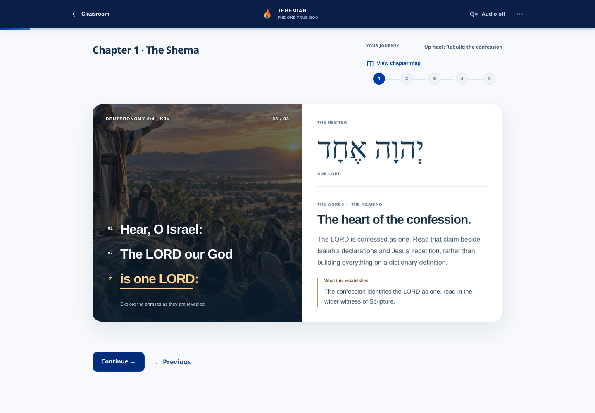 [Full page](teaching-progression-evidence/before/1440-phrase-3-full.png) · [Action](teaching-progression-evidence/before/1440-phrase-3-action.png) |  [Full page](teaching-progression-evidence/after/1440-phrase-3-full.png) · [Action](teaching-progression-evidence/after/1440-phrase-3-action.png) |
| Deut 6:4–5 → the question | 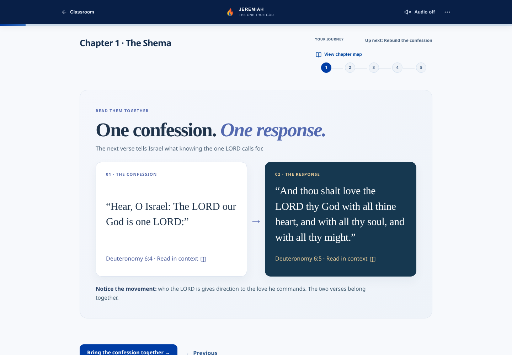 [Full page](teaching-progression-evidence/before/1440-connection-full.png) · [Action](teaching-progression-evidence/before/1440-connection-action.png) |  [Full page](teaching-progression-evidence/after/1440-connection-full.png) · [Action](teaching-progression-evidence/after/1440-connection-action.png) |
| Echad introduction | 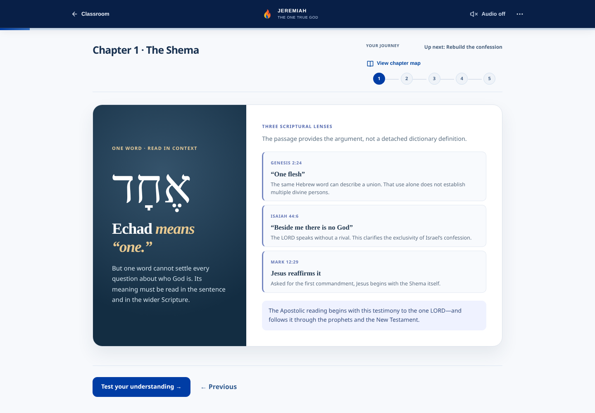 [Full page](teaching-progression-evidence/before/1440-echad-intro-full.png) · [Action](teaching-progression-evidence/before/1440-echad-intro-action.png) | 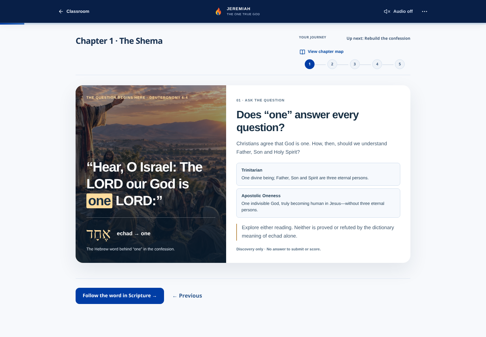 [Full page](teaching-progression-evidence/after/1440-echad-intro-full.png) · [Action](teaching-progression-evidence/after/1440-echad-intro-action.png) |
| Echad evidence → conclusion |  [Full page](teaching-progression-evidence/before/1440-echad-intro-full.png) · [Action](teaching-progression-evidence/before/1440-echad-intro-action.png) | 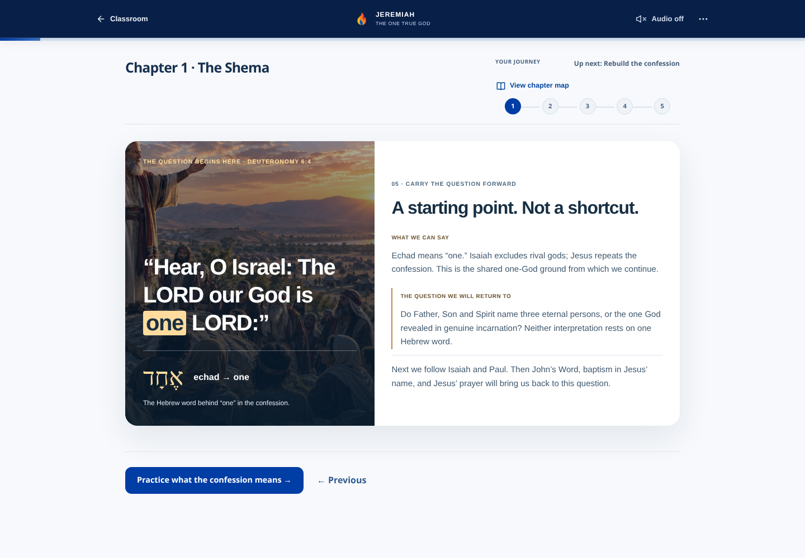 [Full page](teaching-progression-evidence/after/1440-echad-conclusion-full.png) · [Action](teaching-progression-evidence/after/1440-echad-conclusion-action.png) |
| Identity introduction → Word | 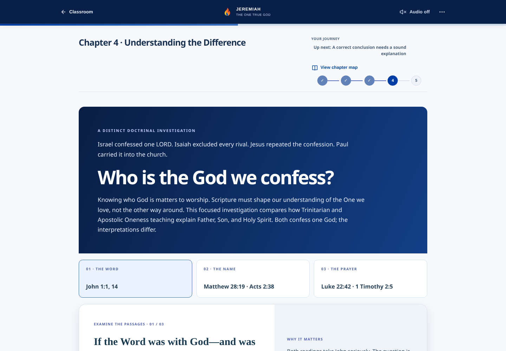 [Full page](teaching-progression-evidence/before/1440-identity-word-full.png) · [Action](teaching-progression-evidence/before/1440-identity-word-action.png) | 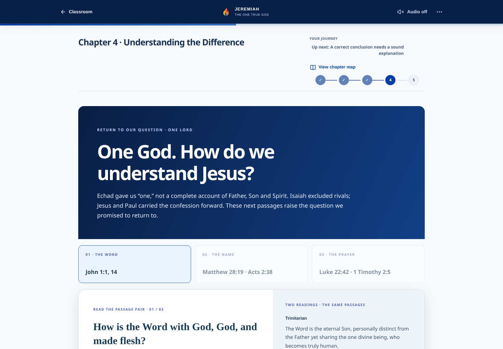 [Full page](teaching-progression-evidence/after/1440-identity-word-full.png) · [Action](teaching-progression-evidence/after/1440-identity-word-action.png) |
| Comparison: both interpretations | 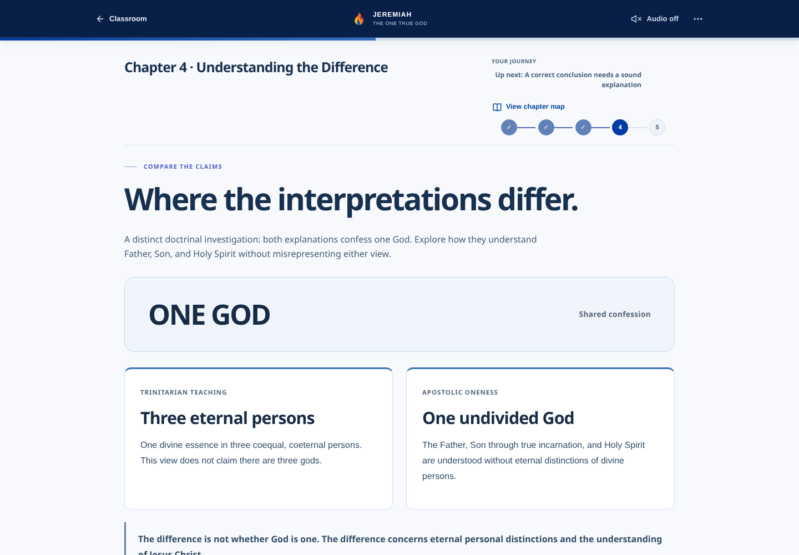 [Full page](teaching-progression-evidence/before/1440-comparison-2-full.png) · [Action](teaching-progression-evidence/before/1440-comparison-2-action.png) | 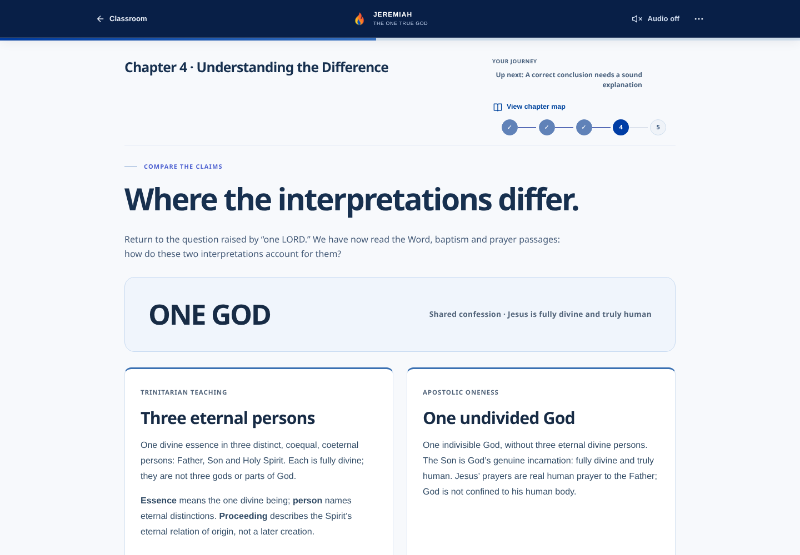 [Full page](teaching-progression-evidence/after/1440-comparison-2-full.png) · [Action](teaching-progression-evidence/after/1440-comparison-2-action.png) |
| Doctrinal synthesis | 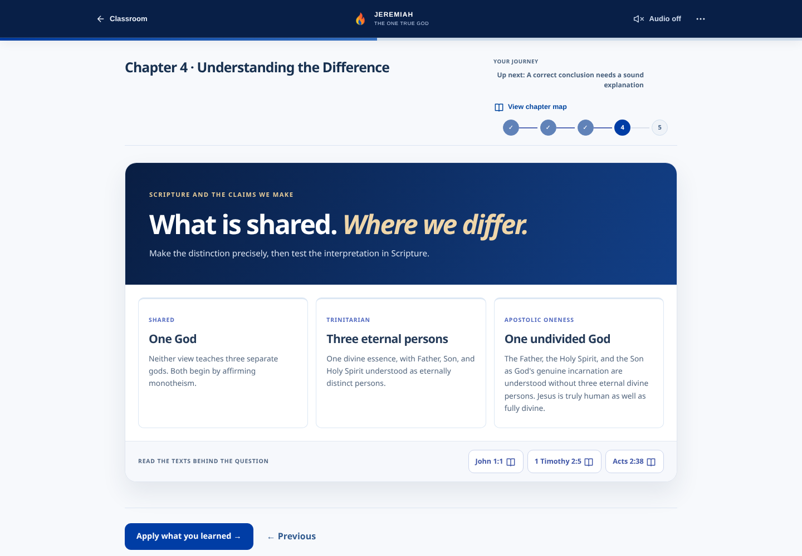 [Full page](teaching-progression-evidence/before/1440-doctrinal-synthesis-full.png) · [Action](teaching-progression-evidence/before/1440-doctrinal-synthesis-action.png) | 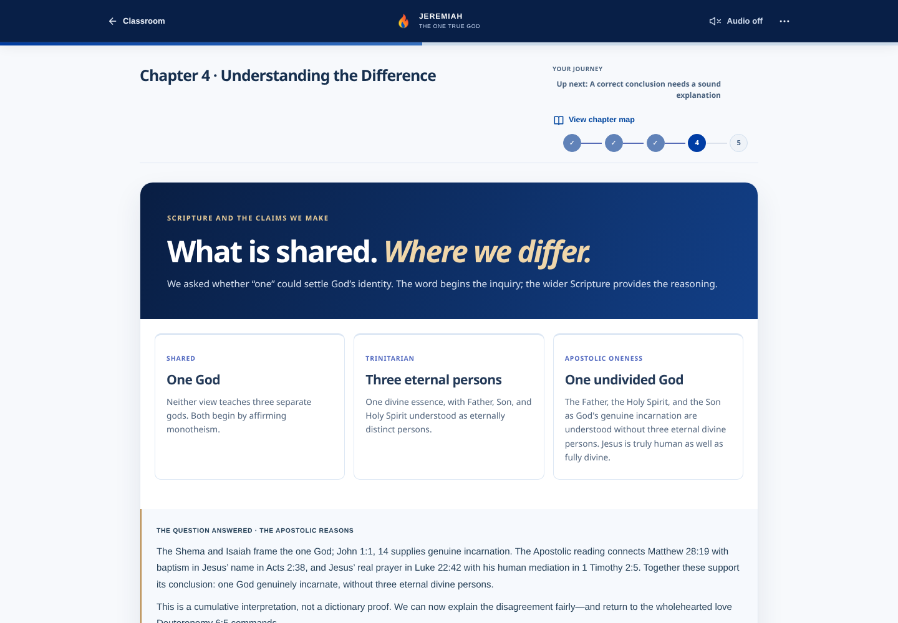 [Full page](teaching-progression-evidence/after/1440-doctrinal-synthesis-full.png) · [Action](teaching-progression-evidence/after/1440-doctrinal-synthesis-action.png) |
| Return to devotion | 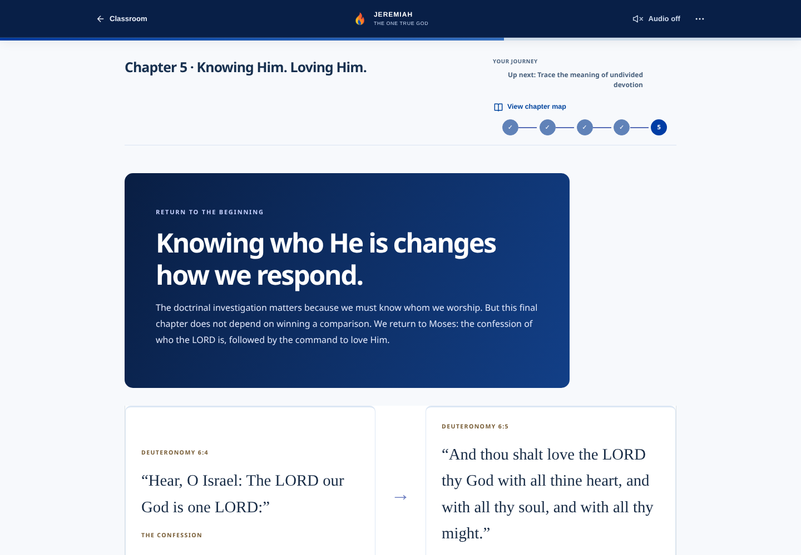 [Full page](teaching-progression-evidence/before/1440-return-devotion-full.png) · [Action](teaching-progression-evidence/before/1440-return-devotion-action.png) | 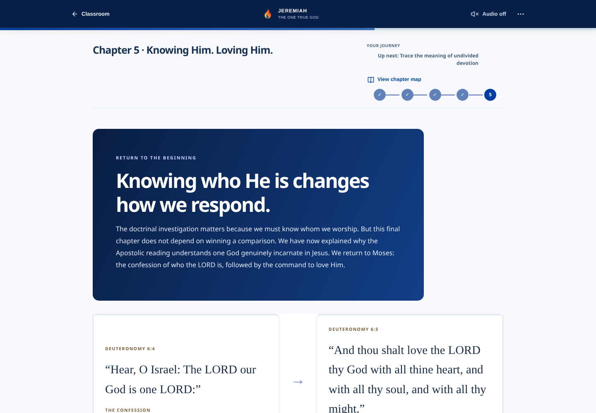 [Full page](teaching-progression-evidence/after/1440-return-devotion-full.png) · [Action](teaching-progression-evidence/after/1440-return-devotion-action.png) |

Additional guided reveals: [Genesis](teaching-progression-evidence/after/1440-echad-genesis-full.png) / [action](teaching-progression-evidence/after/1440-echad-genesis-action.png); [Isaiah](teaching-progression-evidence/after/1440-echad-isaiah-full.png) / [action](teaching-progression-evidence/after/1440-echad-isaiah-action.png); [Jesus](teaching-progression-evidence/after/1440-echad-jesus-full.png) / [action](teaching-progression-evidence/after/1440-echad-jesus-action.png); [Baptism](teaching-progression-evidence/after/1440-identity-name-full.png) / [action](teaching-progression-evidence/after/1440-identity-name-action.png); [Prayer](teaching-progression-evidence/after/1440-identity-prayer-full.png) / [action](teaching-progression-evidence/after/1440-identity-prayer-action.png); 

## Preservation and progress

- Approved `ShemaPhraseStudy` helper and the complete `ShemaExperience.css` are byte-for-byte identical to PR #60. Approved Moses imagery, witness opening, chapter arrival, brand styles, red survey alert and floating feedback are preserved.
- No standards, Scripture datasets, instructional move identifiers, prompts/rubrics, assessment questions, scoring engines, progress/history/archive or survey schemas were edited. No backend, public assets, dependencies, narrator manifest or hosting edits.
- No new scene inserted into the persisted sequence. The existing echad scene has five local reveals and identity has three, using the existing reversible scene navigator. No persisted schema/migration, new mastery evidence or grading criteria.
- Optional interpretation exploration and reached-pair review are tested against the full saved state; they change no assessment/progress data. Independent recall is still separate and unchanged.
- The narrator uses the original authorized identity introduction at the first reveal rather than repeating it for each pair. Global controls and failure behavior remain. The narration test now checks that first-reveal condition rather than the former single-state source expression.

[Preservation verification](teaching-progression-evidence/checks/preservation.txt).

## Verification and limits

- Production build: pass.
- All **23 repository CI test commands**: pass. [Results](teaching-progression-evidence/checks/issue61-tests.json).
- Existing Stage 1 browser: pass (all lesson destinations, exam, review/report/summary/survey, archives/restart, audio/failures, contrast).
- Existing Stage 2 browser: pass (unchanged authored written prompts, autosave/reload, support provenance, unscored continuation, independence, retained evidence, map, responsive UI, fair comparison). Its former fixed four-click comparison assumption was replaced by bounded navigation to **both** rendered interpretations; the equal-treatment assertion is unchanged.
- Original Shema-card browser: pass (all three approved phrases at phone/desktop/320px, original explanation/KJV, future gates, keyboard, history review and missing images).
- New fresh-learner browser: pass on phone/desktop through actual preceding teaching and assessments. Asserts all Hebrew reveals and all three identity pairs on the main route; verifies visible reasoning, full theological terms before assessment, exact context-link destinations, explicit payoff, keyboard review and no discovery grading.
- New short-phone check: 320×440, reduced motion, keyboard activation/focus, 200% root text size with no clipping inside the card, image failure and no horizontal overflow. [Short viewport](teaching-progression-evidence/after/320-short-reduced-motion.png), [200% text](teaching-progression-evidence/after/320-large-text-full.png), [image fallback](teaching-progression-evidence/after/320-image-fallback.png).
- Lint: **11 pre-existing errors / 6 warnings**, no new findings. Every reported file is byte-identical to PR #60. [Log](teaching-progression-evidence/checks/issue61-lint.log).

[Before actual route](teaching-progression-evidence/before/flows.json) · [After actual route and CTA geometry](teaching-progression-evidence/after/flows.json) · [Build/test/browser logs](teaching-progression-evidence/checks/).

These checks demonstrate visible teaching, navigation, data preservation and simulated failure handling. They do not establish that a real student comprehends or retains the theology. Owner visual/content feedback and learner explanation in their own words remain the acceptance step before expanding the approach.

Reproduce against a local production server on 4184 with Playwright/Chromium available:

```sh
cd app
npm run build
PORT=4184 npm start
# Another shell:
NODE_PATH=/path/to/playwright/node_modules node scripts/verify-teaching-progression-browser.cjs after
```

Runner options: `JEREMIAH_REVIEW_URL`, `JEREMIAH_SCREENSHOT_DIR`, `CHROMIUM_PATH`. Run phase `before` against exact PR #60 to reproduce the baseline. The checked-in logs include the existing Stage 1/Stage 2/Shema runners.

## Review boundary

New draft PR targets PR #60's branch. No merge, production deployment, domain or Vercel configuration change. The existing Vercel account recently rejected preview builds with a 24-hour rate limit; the PR will report its actual latest preview status. Committed screenshots are reviewable regardless of hosted preview availability.
