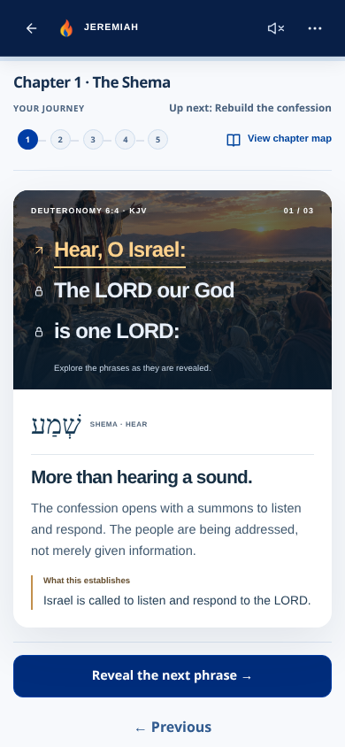
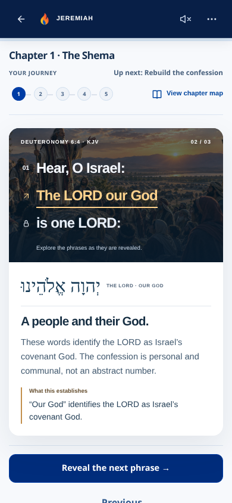
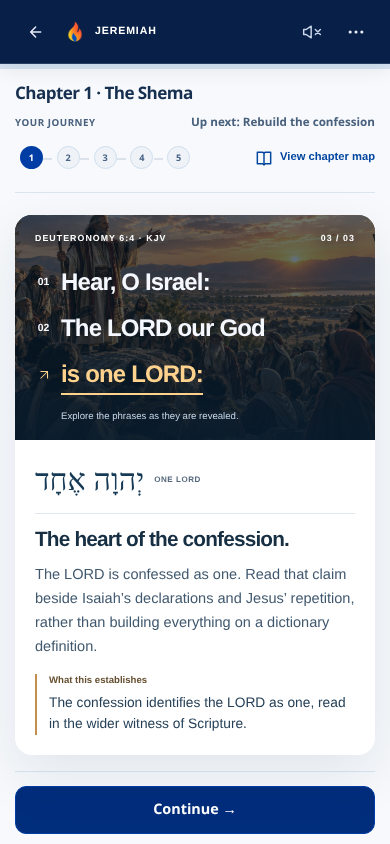
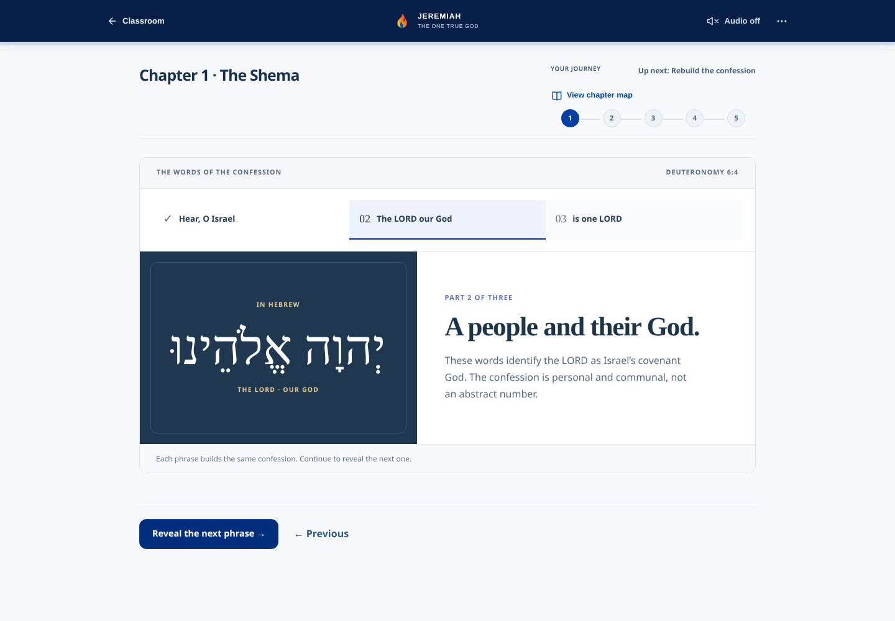
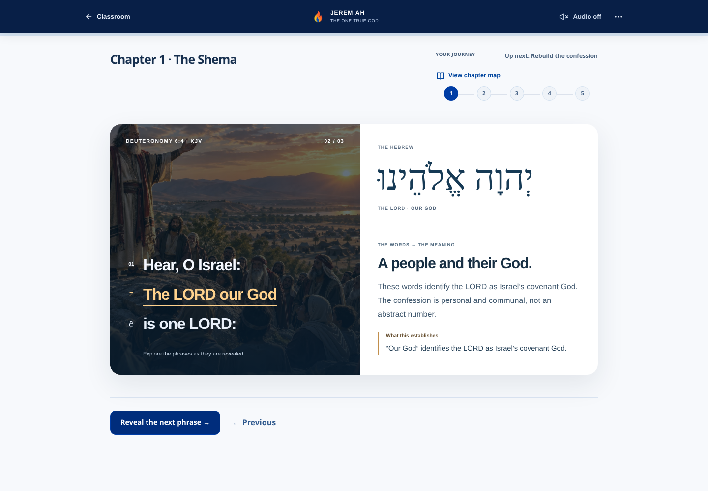

# Issue #56 — one live Shema discovery card

## Scope and starting point

Branch: `codex/shema-premium-card-prototype`, from `feature/mobile-home-classroom-theme-pass1` at `7a64e28fb500d0e68a7531895223b072a581edbd`. PR #55 is not merged, used as a source, or layered into this implementation. The prototype changes exactly one phrase-study interaction and its scoped styles, with a new browser test and this review evidence.

The rest of Classroom, Home, global theme, navigation, narrator, recitation, writing workspace, assessments and history are untouched. This is the design gate: no rollout to other cards or chapters is authorized by this implementation.

## The interaction

A single image-led discovery card holds the confession and its meaning. The original approved Moses/Israel illustration carries the actual Deuteronomy 6:4 context. The selected KJV phrase turns warm gold and gains a short animated underline; its Hebrew and teaching respond in the same card. Each state explicitly says what the wording establishes. There is no score, points reward, simulated mastery, drag gimmick, fake artifact, or new audio control.

Desktop pairs a scene and interactive passage with a full teaching reveal. Phone composes the scene above a compact Hebrew/meaning surface. Only this card gets a compact phone chapter indicator; other learning screens keep their pre-#55 layout. At 390×844 from scroll position zero, the primary action ends at about 788 / 810 / 834px across the three states. The full page includes Previous and some bottom padding; screenshots below include both full-page views and exact 844px viewport views. Short 320×440 screens can scroll normally.

## 45–60 second interaction walkthrough

Start timing once the phrase card is on screen:

| Time | Where the learner touches / looks | Educational response |
| --- | --- | --- |
| 0–12s | Read **Hear, O Israel:** over the Moses/Israel scene; look at the Hebrew and the explanation below/beside it. | The full original explanation says this is a summons to listen and respond, not merely information. “What this establishes” explicitly names Israel’s call to respond to the LORD. |
| 12–25s | Tap the existing **Reveal the next phrase** primary action. | **The LORD our God** becomes the selected phrase. Its Hebrew, title and original explanation appear together: Israel’s covenant God, personal and communal rather than an abstract number. The takeaway names that covenant identification. |
| 25–40s | Tap **Reveal the next phrase** again. | **is one LORD:** becomes selected. The original explanation confesses the LORD as one and directs the learner to Isaiah/Jesus and wider Scripture, rather than a detached dictionary claim. The takeaway states that connection directly. |
| 40–50s | Tap a previously reached phrase to compare; keyboard users can Tab/Enter or use Left/Right/Home/End among reached phrases. | Hebrew and meaning revisit together. This changes the inspected phrase, not grades, evidence, history or mastery. Future phrases remain locked until the existing reveal sequence reaches them. |
| 50–60s | Tap the existing **Continue** action. | The card transitions to the existing next lesson scene (optional film where present). The original reconstruction, independent recall and writing/assessment sequence remain downstream. No new question or grading rule is introduced. |

New phrase discovery still uses the existing primary action. This intentionally preserves Stage 2’s authored sequence; direct taps are for reached phrases. There is no additional per-phrase audio CTA. The one global narrator and optional opening Scripture listen remain as before.

### Reaching this prototype in the real app

Open the branch preview at `/#pilot`, accept the existing adult-pilot consent and Start the lesson. Follow: **Meet the witnesses → Meet Isaiah → Meet Jesus → Meet Paul → Begin Chapter 1 · The Shema → Examine the words**. This path was verified in a fresh browser without seeded storage. The synthetic screenshot fixtures jump directly to the same live state for repeatable comparisons; there is no disconnected mock page or test-only application route.

## Teaching preservation

All three original phrase titles, Hebrew/transliterations and complete meaning paragraphs remain. A small local `ESTABLISHES` map summarizes those existing explanations; it does not change a standard, rubric, assessment, source lesson or Scripture. The interactive confession preserves the KJV wording and punctuation: “Hear, O Israel: The LORD our God is one LORD:”. The new test checks the complete visible explanations and this exact assembled wording.

The image is the already assigned `/images/og1/og1-moses-shema.webp`, selected through the existing visual catalog/intelligence and failure hook. No new image, font, external media or dependency was introduced. If the scene fails, a plain dark fallback keeps all words, Hebrew, teaching, controls and takeaways usable. It does not invent replacement art.

## Real before/after screenshots

Captured in Chromium at deviceScaleFactor 2, exported at CSS resolution. The before app was built from `7a64e28` before modifications. Phone 390×844, desktop 1440×1000, short-phone 320×440. These are actual live application states, not image-generation outputs.

| Same phrase state | Phone before | Phone after | Desktop before | Desktop after |
| --- | --- | --- | --- | --- |
| Phrase 1 | [390 before](shema-card-evidence/before/390-phrase-1.png) | [390 after](shema-card-evidence/after/390-phrase-1.png) | [1440 before](shema-card-evidence/before/1440-phrase-1.png) | [1440 after](shema-card-evidence/after/1440-phrase-1.png) |
| Phrase 2 | [390 before](shema-card-evidence/before/390-phrase-2.png) | [390 after](shema-card-evidence/after/390-phrase-2.png) | [1440 before](shema-card-evidence/before/1440-phrase-2.png) | [1440 after](shema-card-evidence/after/1440-phrase-2.png) |
| Phrase 3 | [390 before](shema-card-evidence/before/390-phrase-3.png) | [390 after](shema-card-evidence/after/390-phrase-3.png) | [1440 before](shema-card-evidence/before/1440-phrase-3.png) | [1440 after](shema-card-evidence/after/1440-phrase-3.png) |

### Exact native phone viewport storyboard

| Discover | Belong | One LORD |
| --- | --- | --- |
|  |  |  |

### Desktop: same card, richer spatial composition

Before:



After:



### Small screen and image failure

| Check | Screenshot |
| --- | --- |
| Short phone before | [320×440](shema-card-evidence/before/320-phrase-3.png) |
| Short phone after, reduced motion | [320×440](shema-card-evidence/after/320-phrase-3.png) |
| Phone image failure | [Fallback](shema-card-evidence/after/390-image-fallback.png) |
| Desktop image failure | [Fallback](shema-card-evidence/after/1440-image-fallback.png) |

## Validation and boundaries

- Frozen Stage 2 dependencies and production build work; existing large-bundle warning remains.
- All 23 unique commands from both existing GitHub CI workflows pass locally. [Results](shema-card-evidence/ci-results.json).
- [Stage 1 browser regression](shema-card-evidence/stage1.log) passes: all authored chapter/next labels, narration Off/failures, video/image failure exits, keyboard restart, archive/history, real ten-question exam, answer review, report/summary/survey, contrast, short viewport/reduced motion.
- [Stage 2 browser regression](shema-card-evidence/stage2.log) passes: authored writing prompts, draft persistence, recall independence, supported/unscored provenance, non-mutating map, reached-phrase review and future locking, retained evidence, audio preference, comparison and responsive writing.
- [New prototype browser test](shema-card-evidence/after.log) passes: all three phrase states at all three sizes, complete approved explanations, exact KJV, no repeated phrase audio, visible keyboard focus, RTL Hebrew, minimum 44px phrase targets, primary action inside 390×844 without scrolling, no overflow/page errors, reduced motion, image failure, original Continue transition and unchanged assessment/history on review. [Measurements](shema-card-evidence/after/metrics.json).
- `git diff --exit-code 7a64e28 -- app/src/core app/src/data app/src/features/home app/src/features/classroom/OG1LessonPlayer.jsx app/src/features/classroom/useLessonNarration.js app/server app/api app/public app/src/features/pilot` passes.
- Lint remains the pre-#55 baseline: 11 errors / 6 warnings, including the already broken Home browser runner apostrophe. That unrelated runner and Home are intentionally not edited in this card-only branch. [Output](shema-card-evidence/lint.log).

Tests use synthetic isolated state and unavailable API fixtures. They do not submit real feedback or call paid narration/AI. No physical-device, screen-reader certification, measured retention, or actual 18-year-old user research is claimed. Whether learners want to discover the next phrase is the owner/human-review acceptance gate. Instructional gaps tracked in Issue #48 remain a separate task; no standards or rubric revisions are hidden in this prototype.

## Reproduce

From `app/`, build then run `PORT=4184 PILOT_FEEDBACK_FILE=/tmp/shema-card-test.jsonl npm start`. With Playwright/Chromium in the review runner:

```sh
JEREMIAH_REVIEW_URL=http://127.0.0.1:4184 node scripts/verify-shema-card-browser.cjs after
JEREMIAH_REVIEW_URL=http://127.0.0.1:4184 node scripts/verify-og1-stage1-browser.cjs
JEREMIAH_REVIEW_URL=http://127.0.0.1:4184 node scripts/verify-og1-stage2-browser.cjs
```

Draft PR and automatic preview links are reported separately. No merge, domain change or production deployment.
