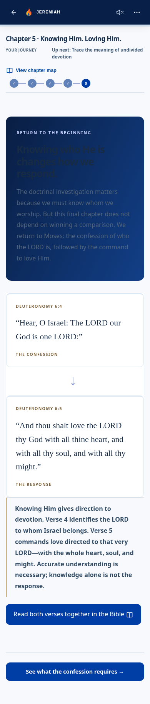
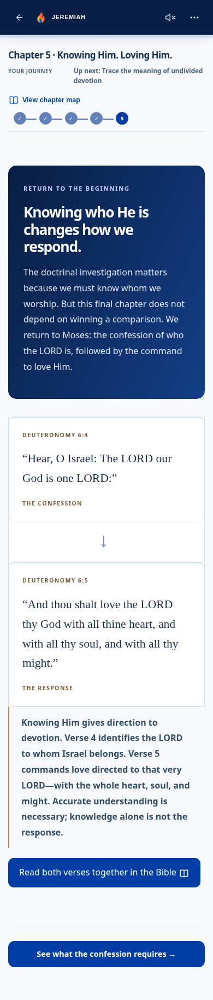
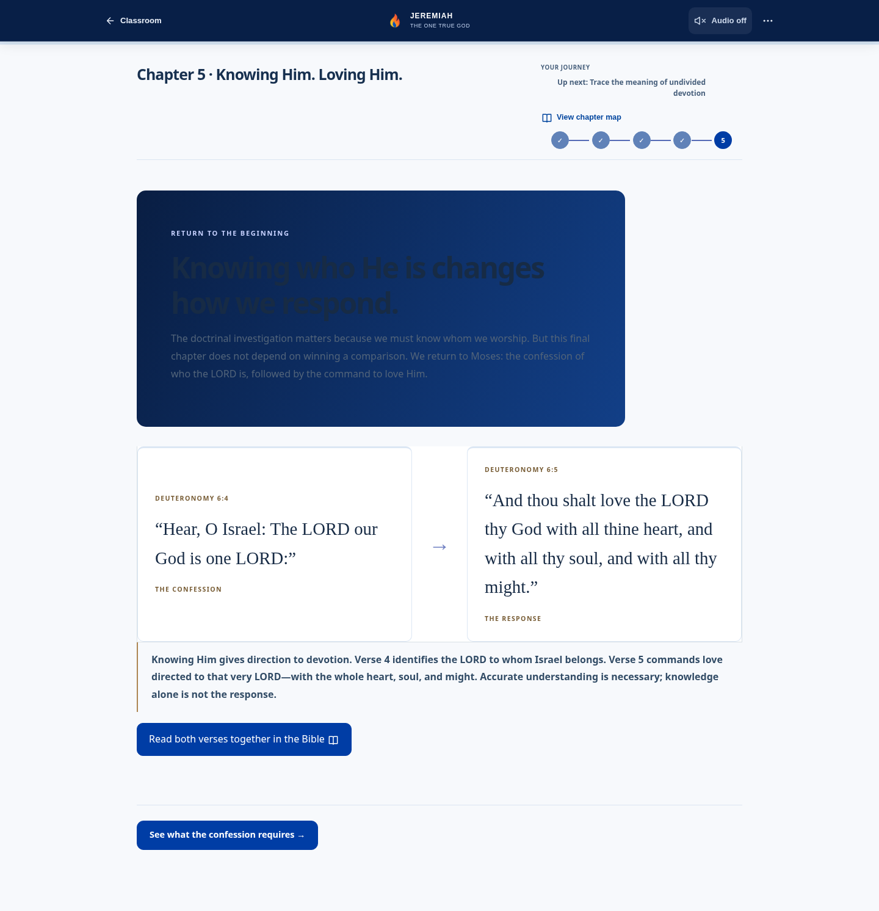
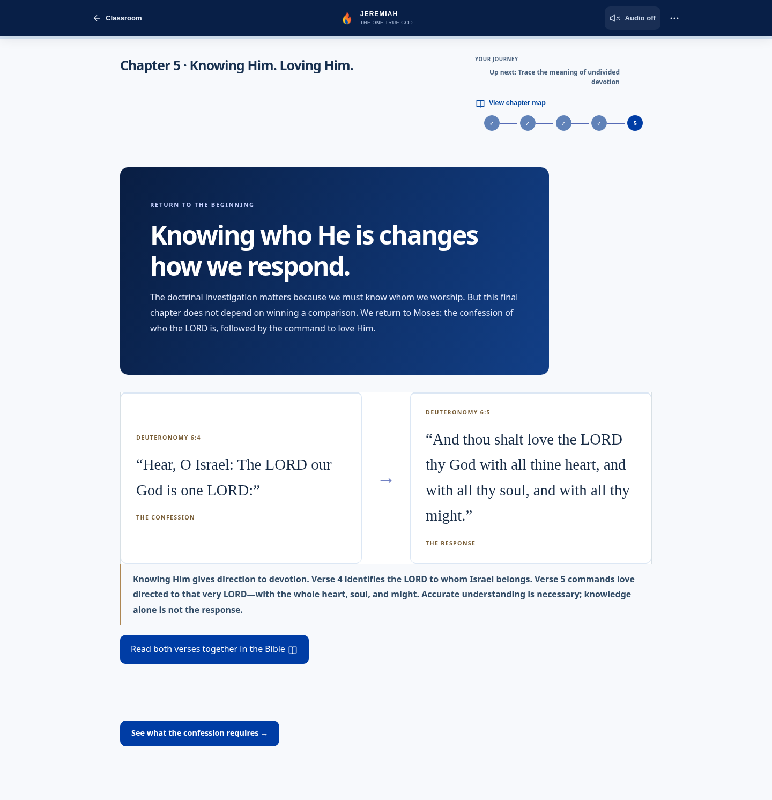
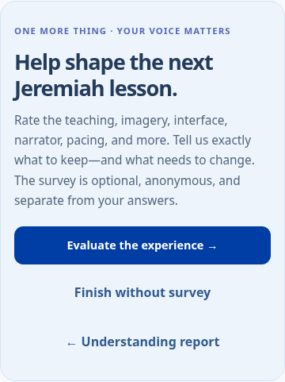
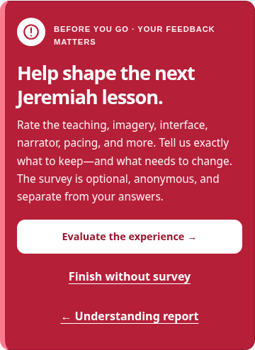
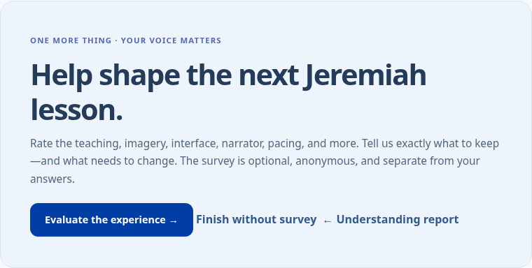
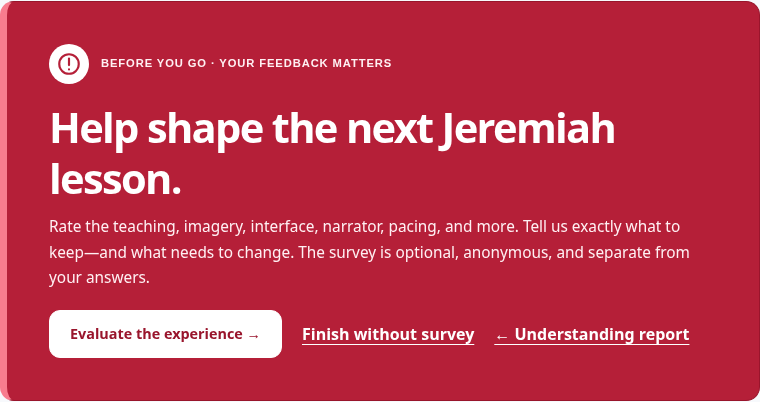

# Readability and feedback-notice follow-up

Follow-up to Issue #59 / draft PR #60, based on the owner's screenshots and request for **red** rather than brown.

## Chapter 5: readable text on the dark panel

The Stage 2 light-surface text rules overrode the intended white heading and pale paragraph while the brand theme retained a blue gradient. The scoped brand-theme selectors now restore white/light text only on `.og1-return-heading`.

Computed contrast across the actual gradient endpoints at both 390×844 and 1440×1000:

| Text | Before | After |
| --- | ---: | ---: |
| Heading | 1.15:1 | 10.06:1 |
| Paragraph | 1.66:1 | 8.23:1 |
| Label | 6.69:1 | 6.69:1 |

| Viewport | Before | After |
| --- | --- | --- |
| Phone |  |  |
| Desktop |  |  |

## Feedback invitation: distinct red notice

Replaced the pale blue surface with deep red, a bright accent edge, a prominent exclamation icon, white text and a white primary action. “BEFORE YOU GO · YOUR FEEDBACK MATTERS” marks the change of purpose. Secondary actions have their own spacing, underlines and 44px minimum targets. No flashing, forced modal or error language. The notice is a labelled region; its decorative icon is hidden from assistive technology.

The original optional/anonymous/separate-from-answers wording and all three existing action handlers are retained. No survey schema, submission/backend or scoring changes.

A red **Feedback · optional** floating button is visible immediately on the final summary, before the learner reaches this invitation. It opens the optional survey directly and disappears on the survey or any lesson screen. Safe-area spacing and extra summary bottom padding keep the final content scrollable above it.

Floating shortcut at the top of the summary: [Phone](feedback-notice-evidence/after/390-floating-top.png), [Desktop](feedback-notice-evidence/after/1440-floating-top.png).

| Viewport | Before | After |
| --- | --- | --- |
| Phone |  |  |
| Desktop |  |  |

## Verification

These are actual Chromium screenshots with targeted Chapter 5/completed-exam state, rather than a fresh-learner traversal. The separate Issue #59 fresh-learner evidence remains in the original report.

- Production build: pass.
- Chapter 5 contrast browser check: pass on phone and desktop, contrast >=4.5:1 for all heading-panel text and no horizontal overflow. Actual values are in `return-contrast-evidence/{before,after}/contrast.json`.
- Feedback browser check: pass on phone/desktop, labelled notice, 44px actions, no horizontal overflow, report navigation, floating shortcut visible at initial scroll with a >=44px target, direct survey entry and shortcut removal, explicit finish-without-survey, returning to the completed lesson and opening the optional survey. Existing exam/history/evidence/mastery remain unchanged. The existing completion flag can update normally upon reentry.
- Existing Stage 1 browser suite: pass, including full exam/report/summary/survey and restart archives.
- Existing climax, theme consistency and pilot-feedback tests: pass.

Reproduce with a local production app on port 4184 and Playwright/Chromium available:

```sh
NODE_PATH=/path/to/playwright/node_modules node app/scripts/verify-return-contrast-browser.cjs after
NODE_PATH=/path/to/playwright/node_modules node app/scripts/verify-feedback-notice-browser.cjs after
```

Both runners accept `JEREMIAH_REVIEW_URL` and `CHROMIUM_PATH`. No merge or production deployment.
